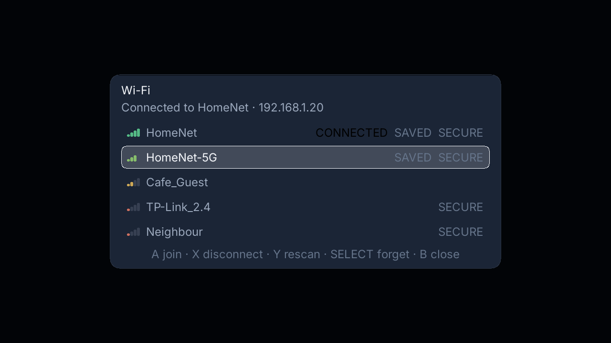
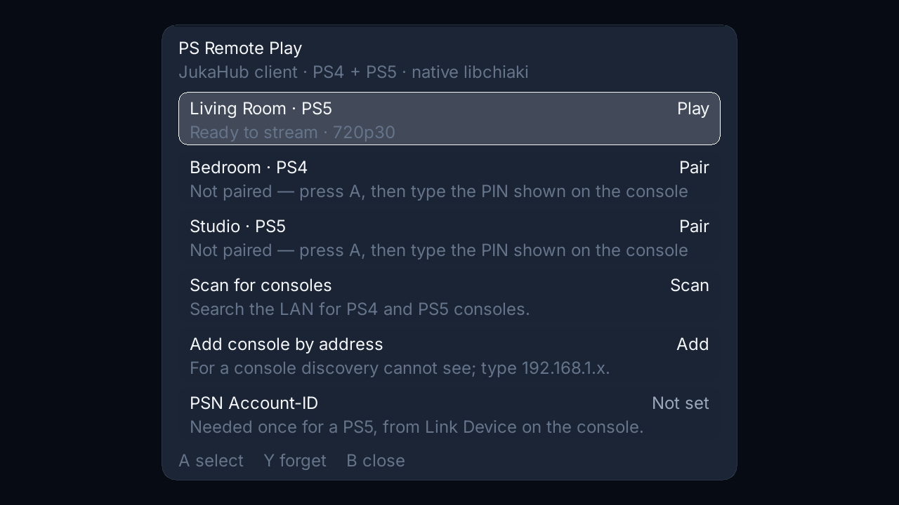
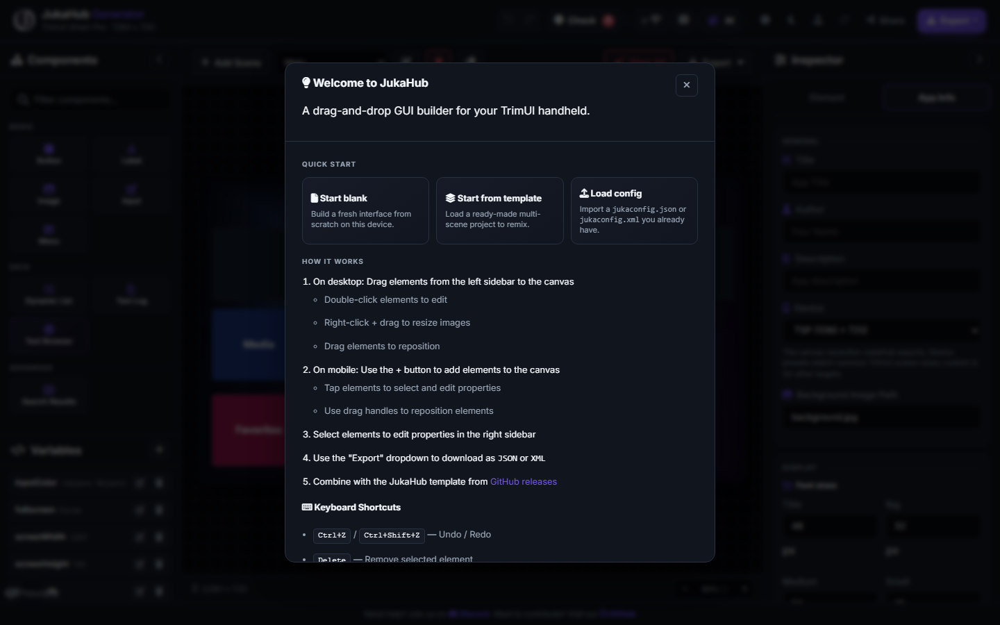
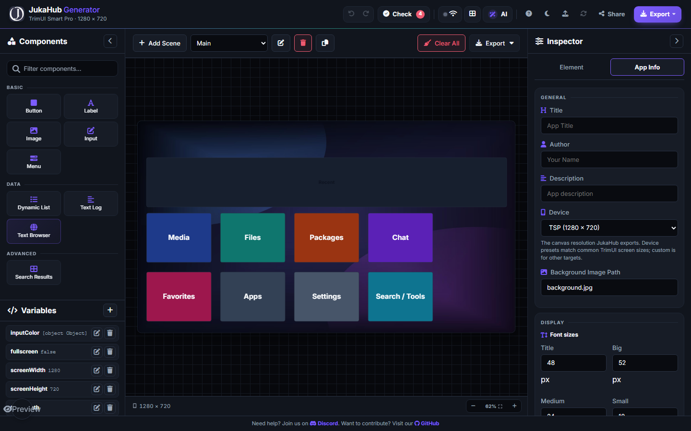
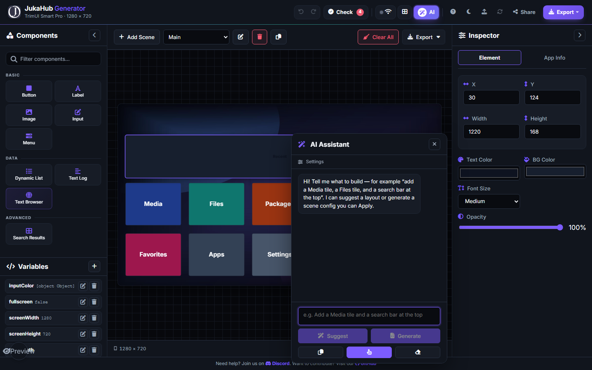
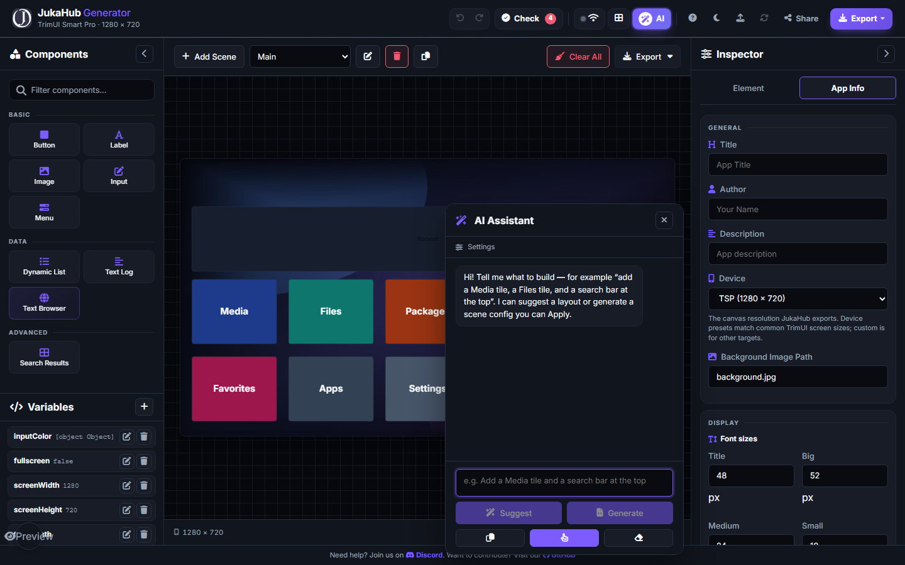
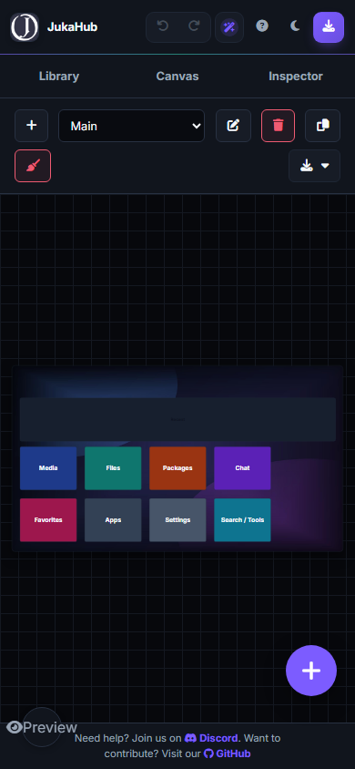

# JukaHub

[](https://github.com/jukaLang/JukaHubV2/actions/workflows/ci.yml)
[](https://generate.jukalang.com)
[](https://github.com/jukaLang/JukaHubV2/releases/latest)
[](https://go.dev/dl/)
[](https://www.libsdl.org/)
[](LICENSE)
[](https://api.scorecard.dev/projects/github.com/jukaLang/JukaHubV2)
[](https://discord.gg/R9qgJjh5jG)


**Your TrimUI handheld as a complete media and gaming console: one folder on
the SD card, the stock OS untouched underneath.**

A media hub for the **TrimUI Smart Pro** — and the whole TrimUI line — with no
firmware swap and nothing to replace. **The shell your handheld should have
shipped with**: YouTube on the couch, your ROM library with box art and
save-resume, PS4/PS5 Remote Play on the train, LAN play in the same room, a
phone as your keyboard — every screen driven by the D-pad you already have.
It is one folder on the card, so installing it is always reversible.

Updates are signed and roll themselves back if a new build misbehaves, and
nothing is uploaded anywhere unless you switch it on. Ten minutes from download
to all of that: the walkthrough is [docs/TOUR.md](docs/TOUR.md).

[Download](https://github.com/jukaLang/JukaHubV2/releases/latest) ·
[Web builder](https://generate.jukalang.com) ·
[Discord](https://discord.gg/R9qgJjh5jG) ·
[Controls](docs/CONTROLS.md) ·
[Developer guide](docs/DEVELOPMENT.md) ·
[Dependencies](docs/DEPENDENCIES.md)

## Contents

**What it is** — [What it does](#one-app-the-whole-card) ·
[JukaHub and Juka](#jukahub-and-juka) · [Why JukaHub](#why-jukahub)

**Install and set up** — [Install](#install-on-a-trimui-smart-pro) ·
[First run](#first-run) · [Controls](#controls) ·
[Copy files from your PC](#copy-files-from-your-pc) ·
[SFTP](#browse-files-over-sftp) ·
[Phone as a keyboard](#use-your-phone-as-a-keyboard) ·
[Cast the screen](#cast-the-screen-to-a-browser) · [Updating](#updating) ·
[Privacy](#privacy)

**When something goes wrong** — [Something is wrong?](#something-is-wrong) ·
[Other devices](#other-devices)

**Reference and contributing** — [Security](#security) · [Toolbox](#toolbox) ·
[Web builder](#build-a-screen-in-the-web-builder) ·
[Share and remix a design](#share-and-remix-a-design) ·
[Contributing](#contributing) · [Documentation](#documentation)

---

## One app, the whole card

JukaHub is one controller-first app for the whole card, running *on top of* the
firmware — not instead of it. Install, uninstall, repeat: it is a folder on the
SD card, and the stock launcher is one Select+Start hold away whenever you want
it back.

* **Watch** — YouTube search and trending, Shorts, saved favourites, podcasts,
  IPTV playlists, a local video player with subtitles, and a text web browser.
* **Play** — a console-by-console ROM library with box art, per-game launchers,
  play time, RetroAchievements progress, save-state auto-resume and LAN play
  (RetroArch netplay, hosted or joined from the library).
* **Keep** — save-folder snapshots with one-tap restore, SD-card health checks,
  battery health, and a Continue list built from what you actually used.
* **Connect** — a LAN watch party, PS4/PS5 Remote Play, casting the screen to a
  browser, typing from a phone, and SFTP/FTP plus SSH file access.
* **Make it yours** — themes and the browser design builder, plus accessibility
  settings: text scaling, high-contrast and colour-blind palettes, button swaps
  and a one-handed chord.
* **Extend** — signed packages from a repository with rollback, and plugins.

Most of these have a page in the [documentation table](#documentation) below.

## JukaHub and Juka

The name is deliberate, and the relationship is easy to misread: **JukaHub is not
a Juka program, and the device needs no Juka runtime to run it.** The launcher is
Go + SDL2 — the one runtime the firmware already ships — because that is what a
handheld with no Python, no build tools and 1 GB of RAM can actually run well.

What it shares with the ecosystem is the data layer: every screen is a
`jukaconfig.json`, authored in the [web builder](https://generate.jukalang.com)
and loaded by the player, so a design moves between the browser and the card
without a rebuild or a recompile. The language itself, its packages and the rest
of the family live at [jukalang.com](https://jukalang.com) and
[github.com/jukaLang](https://github.com/jukaLang); this repository is the
handheld end of it, and the format both halves agree on is documented in
[docs/CONFIGURATION.md](docs/CONFIGURATION.md).

## Why JukaHub

Four things separate it from the other TrimUI frontends, and each one has a page
because it is a design decision rather than a feature bullet.

* **The interface is data.** Every screen is `jukaconfig.json` — elements,
  bounds, triggers and theme tokens — so a layout can be changed without
  touching Go. The [web builder](https://generate.jukalang.com) edits the same
  file the device reads; see [docs/CONFIGURATION.md](docs/CONFIGURATION.md).
* **Updates work like a package manager.** A signed repository, staged
  installs, SHA-256 *and* Ed25519 verification, a rollback copy and an
  interrupted-install recovery — not "download the zip and hope". See
  [docs/PACKAGES.md](docs/PACKAGES.md) and [Updating](#updating).
* **The UI is tested, not just the logic.** Scene audits, offscreen render
  probes and PNG dumps catch layout drift headlessly (`JUKAHUB_SCENE_DUMP_DIR`),
  which is how several of the bugs in
  [docs/IMPROVEMENTS.md](docs/IMPROVEMENTS.md) were found before a user hit them.
* **Breadth without a second app.** Watch party, PS4/PS5 streaming, the video
  and music players, FTP/SFTP, plugins, the accessibility panel and opt-in
  telemetry all ship in the same folder, on top of the stock firmware.

The comparison that produced this list — item by item against BrickOS, including
what is deliberately *not* copied — is in
[docs/IMPROVEMENTS.md](docs/IMPROVEMENTS.md). What is still missing is listed
honestly in [docs/FEATURE-BACKLOG.md](docs/FEATURE-BACKLOG.md).

## Install on a TrimUI Smart Pro

Five steps, no firmware swap, works on the stock OS and on CrossMix. You need
the handheld, its SD card, and Wi-Fi.

1. Download **`JukaHub-Trimui.zip`** from
   [Releases](https://github.com/jukaLang/JukaHubV2/releases/latest).
2. Turn the device off and put the SD card in your computer.
3. On the card, open the **`Apps`** folder and create a folder named
   **`JukaHub`** inside it.
4. Extract **all files** from the download into `Apps/JukaHub`.
5. Put the card back in, power on, and open **Apps → JukaHub**.

When you are done the folder looks like this:

```text
SDCARD/Apps/JukaHub/
├── JukaHub            <- the application
├── launch.sh
├── config.json        <- the Apps-menu entry
├── jukaconfig.json    <- the interface
├── JukaPlayer.png
├── Inter-Regular.ttf
└── background.jpg
```

That's the whole installation. There is nothing else to set up:

* the firmware already ships SDL2, so there are no extra libraries,
* no Python and no build tools are needed on the device,
* `yt-dlp` and `ffmpeg` download themselves on first launch (needs Wi-Fi; the
  first start takes a minute or two, later starts are instant).

If JukaHub does not appear in **Apps**, reboot the device — the stock launcher
only scans `Apps/` at boot. Also check that the folder is exactly
`Apps/JukaHub` and that `launch.sh` is inside it.

> **Here to build it, not just use it?** Clone to a running build in about five
> minutes with [docs/QUICK_START.md](docs/QUICK_START.md), pick up work labelled
> [`good first issue`](https://github.com/jukaLang/JukaHubV2/labels/good%20first%20issue),
> and read [Contributing](#contributing) for the rules that keep the suite green.

## First run

Home is a grid of tiles: **Continue**, **Media**, **Files**, **Packages**,
**Apps**, **Favorites**, **Browser**, **Chat**, **Tools**, **Emulator**,
**Settings**, plus **Exit** in the footer. The PS4/PS5 launcher tiles and the
phone-pairing QR sit just under the top bar on the right; the weather chip, the
clock and the notification bell are in the bar itself.

* **Media / Tube** — YouTube search and trending.
* **Music** — open any audio file from the browser and the player takes its
  folder: shuffle that visits each track once, repeat off/all/one, a play-next
  queue, favorites that survive a restart, 0.75×–2× speed, a sleep timer,
  synced `.lrc` lyrics and a full-screen spectrum. Playback continues while you
  browse; see [docs/MUSIC_PLAYER.md](docs/MUSIC_PLAYER.md) for the feature map
  and roadmap.
* **Offline music** — **Start → Tools → Downloads** saves a link as an m4a on
  the card:
  a queue with live progress and speed, pause/resume, per-row retry and the SD
  card's own usage bar. Saved tracks open in the audio player, so a downloaded
  album plays with Wi-Fi off; see [docs/CONTROLS.md](docs/CONTROLS.md#downloads).
* **Photos** — open PNG, JPG, BMP and WebP images from the file browser, then
  browse the folder with Left/Right and zoom with Up/Down. WebP box art decodes
  natively on the handheld, whose SDL_image links libwebp; a desktop runtime that
  ships an SDL2_image without libwebp detects that at startup and skips WebP
  files instead of showing a broken picture.
* **Dock & ambient** — while charging (after 45 quiet seconds) or idle, the
  screen becomes a dock display: a large clock, today's weather, the track that
  is playing and a slideshow from your Photos folder. Y arms a sleep timer, X
  blanks the panel while audio keeps playing, and an alarm wakes it. Open it by
  hand from **Start → Ambient**; see [docs/AMBIENT.md](docs/AMBIENT.md).
* **Favorites** — save links and reopen them later.
* **Apps** — a tile launcher for the other apps on the card, plus built-in
  extras (JukaLand, Weather, and **Browser**, a text web browser with GitHub
  issue quick links; see [docs/BROWSER.md](docs/BROWSER.md)). Every installed
  app is drawn with its own icon — the `icon.png`/`config.json` art of an app
  folder, an image stored next to the program, or the icon Windows reports for
  a shortcut — and falls back to a coloured initial when it has none.
* **Wi-Fi** — a first-party network picker: scan, join with the on-screen
  keyboard, reconnect saved networks without retyping the password, disconnect
  and forget. Open it from **Quick Settings → Wi-Fi Networks** or **Hardware →
  Wi-Fi**; see [docs/WIFI.md](docs/WIFI.md).

  
* **Settings** — playback resolution, weather and 25 colour themes
  (Dark, Light, High Contrast, Anime, Cute, Girly, Fallout, Matrix and more).
  **Smart Widgets** (from General) holds the settings that react to the device
  on their own: battery saver, which drops to the slowest cadence, stops UI
  motion and switches to the OLED theme below 20% until it is charged again;
  the optional time-of-day theme (dawn, day, evening, night); and start at
  login, which is off by default.
* **Game Profiles** — launch Windows games through Box64/Wine, native
  binaries and scripts. Profiles live in `Apps/JukaHub/data/game-profiles`;
  see [docs/GAME_PROFILES.md](docs/GAME_PROFILES.md) for the format and the
  import/export workflow.
* **Smart Pro Compatibility** — per-game community reports, an honest
  hardware tier when nobody has reported a title yet, one-press boost plans for
  N64/Dreamcast/PSP, and a manager for multiple libretro core builds. **U**
  (or **L1**) on the Core-builds tab checks the libretro aarch64 buildbot and
  pools newer builds of the installed cores, checksum-checked and never
  activated behind your back; standalone emulator releases are fetched to
  `data/emulator-updates` and reported, not installed. Reports
  and core pools live in `Apps/JukaHub/data/performance`; see
  [docs/COMPATIBILITY.md](docs/COMPATIBILITY.md).
* **Windows Apps** — scan for `.exe` files and launch basic Windows programs
  through Wine. On TrimUI's no-X11 firmware it can route through WestonPack's
  DRM/KMS compositor instead of failing on a missing display. If DXVK is
  installed beside Wine and a Vulkan loader is present, Direct3D DLL overrides
  are enabled automatically; see [docs/WINDOWS_APPS.md](docs/WINDOWS_APPS.md)
  for the runtime setup.
* **Games Library** — **Emulators → Games Library** browses `Roms/<system>/`
  console by console, shows the box art downloaded for each title, and launches
  the game with the emulator that owns its system. Drop a short clip in
  `data/game-snaps/` and the preview box plays it while the focus rests on that
  game. Every launch is recorded, so
  the **Continue** row at the top resumes the last game in one press. **X** on a
  game opens **LAN Play**: host it, or join another device over Wi-Fi, so link
  cable titles like Mario Kart and Four Swords play without a cable. **Tools →
  Disc helpers** fills in the cue sheets and multi-disc playlists that
  PlayStation and Sega CD rips need, without touching an existing file. See
  [docs/GAME_LIBRARY.md](docs/GAME_LIBRARY.md).
* **PortMaster Ports** — install PortMaster from the Emulators screen and launch
  the ports it manages without leaving JukaHub. Installed launchers are read
  from `Ports/` and the older `Roms/Ports` locations; see
  [docs/PORTMASTER.md](docs/PORTMASTER.md).
* **Save Manager** — snapshot every emulator save folder into a versioned copy,
  restore one with a safety snapshot first, prepare the folders for Syncthing
  and export a phone resume bundle. Snapshots are plain files on the card, so
  they work without JukaHub; see [docs/SAVE_MANAGER.md](docs/SAVE_MANAGER.md).
* **Curation Hub** — a device-specific layer over the Store: an essentials
  checklist for a new card, shareable theme + text-size profiles tuned per
  panel, and compatibility votes for games and PortMaster titles. It works
  offline; see [docs/CURATION.md](docs/CURATION.md).
* **Accessibility** — global text scaling (85–145%), a high-contrast palette,
  three colour-blind-safe palettes and a system-wide A/B / X/Y controller
  remap, all from one panel in the Start menu; see
  [docs/ACCESSIBILITY.md](docs/ACCESSIBILITY.md).
* **PS Remote Play** — JukaHub's own PS4/PS5 client, with no Python launcher
  and no dependency on a separate Chiaki-ng install. It scans the LAN, pairs
  over the LAN (**Link Device** PIN; PS5 also needs the PSN Account-ID),
  remembers consoles and quality, and streams through the bundled
  `chiaki-stream` native helper. PS4 pairing is pure Go, so a PS4 works even
  before the helper is present. **PS4** and **PS5** tiles in the home header,
  left of the phone-pairing QR, open the panel in one press and are reachable
  with the D-pad (`Up` from the card beneath them) and **A**. JukaHub hands the
  screen to the helper and closes while it runs; the stock menu returns when the
  stream ends. See [docs/REMOTE_PLAY.md](docs/REMOTE_PLAY.md).

  

* **Smart home** — **Start → Smart Home** drives Home Assistant entities,
  mirrors every toggle to MQTT, shows the Pi-hole, router and Tailscale state,
  and connects or disconnects the tunnel. WireGuard is status-only because
  `wg-quick` needs root. See [docs/SMART_HOME.md](docs/SMART_HOME.md).
* **Logs** — view or export the app log if something misbehaves.
* **Tools** — this device's IP address, a built-in FTP server for quick file
  drops over Wi-Fi, an SSH/SFTP server for browsing the file system from a PC
  (also under **Tools → FTP & IP**), the phone companion that turns a phone
  into a keyboard, remote and file drop, **Remote Cast** to watch the screen
  live in a browser, and **Community & support** for the
  changelog, bug reports and the anonymous-diagnostics switch. **Power tools**
  adds a gateway or clipboard-host port scan, ping/traceroute, DNS and Wi-Fi
  checks, a hex/JSON/log viewer, clipboard-saved script buttons, rsync and Syncthing checks,
  jukauser.json snapshots with diff/rollback, and a read/write benchmark
  board.

Turn Wi-Fi on in Quick Settings, then join a network from **Quick Settings →
Wi-Fi Networks** before using YouTube or weather. Your settings are stored in
`Apps/JukaHub/jukauser.json` and survive updates.

## Controls

D-pad moves, **A** confirms, **B** goes back, **X** and **Y** are the secondary
and tertiary actions, **L1/R1** move between sections and pages, **Start** opens
the Start menu — scenes in one group, games, tools and device actions in the
others, so switching screen or taking a screenshot is two presses away.

To leave the app, hold **Select + Start** together. JukaHub saves and plays its
goodbye screen, then returns to the stock launcher — this works from any screen,
including while a video is playing or a panel is open.

Press **F1** on a desktop build for the full list as an in-app overlay. Per-screen
tables (Live TV, video player, on-screen keyboard, music player, Pomodoro,
alarm, calculator, terminal, JukaLand, desktop keys) are in
**[docs/CONTROLS.md](docs/CONTROLS.md)**.

## Copy files from your PC

1. Connect the handheld to the same Wi-Fi as your PC.
2. Open **Tools** and note the **IP address** (press A to copy it).
3. Start the **FTP server**. The panel shows the address to type, such as
   `ftp://192.168.1.42:2121`.
4. On your PC, paste that address into Explorer/Finder (or any FTP client) and
   drop files into the SD card (on Windows the share is a `shared` folder next
   to the app, so your settings and saved logins are never exposed).

The FTP server stays on until you stop it or close JukaHub. Turn it on only on
a network you trust: while it runs, anyone on the same Wi-Fi can read and write
the shared folder — login accepts any username and password by design.

## Browse files over SFTP

For `scp`, backup scripts and editors, **Tools → SSH / SFTP** starts a server
that only speaks SFTP. The panel shows an address such as
`sftp://juka@192.168.1.42:2222` and a one-time password for the `juka` account;
connect with WinSCP, FileZilla, Cyberduck, Finder or the `sftp` command line.
(Windows Explorer only speaks FTP, so use the server above or install an SFTP
client.)

Unlike FTP this is not open to the network: the password is random and
regenerated every start, guesses are limited, and shell commands, port
forwarding and tunnels are refused. Paths cannot escape the root, including
through symlinks, and the host key is saved once in the app data folder. Press
**A** on the row (or run `ssh off`) to stop it.

The password is shown on the device only and is never written to
`jukauser.json` or the log. For unattended access, put your public key in
`Apps/JukaHub/data/ssh_authorized_keys` (OpenSSH format). Advanced settings:

| Variable | Effect |
|----------|--------|
| `JUKAHUB_SSH_PORT` | Port to listen on (default `2222`), or set `ssh_port` in the config |
| `JUKAHUB_SSH_ROOT` | Folder to expose instead of the whole file system |
| `JUKAHUB_SSH_READONLY=1` | Refuse every upload, rename and delete; or set `ssh_readonly` in the config |
| `JUKAHUB_COMPANION_PORT` | Port for the phone companion page (default `8317`) |

## Use your phone as a keyboard

Typing a search on a D-pad is slow. **Tools → Phone companion** shows a QR
code; scan it with your phone camera (phone and handheld on the same Wi-Fi) and
the phone opens a small page with:

* **Type** — a text box whose contents appear in whichever field has focus,
  with an optional Enter after each send.
* **Remote** — D-pad, A/B/X/Y, Start, Back and the shoulder buttons.
* **Send a link** — paste a YouTube, direct-video or stream link and it starts
  playing on the handheld.
* **Send a file** — uploads land in the `PhoneDrop` folder of the shared folder
  (the same one FTP publishes), ready for the file browser or player.

The QR code carries a fresh six-digit PIN, so nothing has to be typed on the
device. The server runs in the background for the whole session, and **Y**
issues a new PIN on the spot (which also invalidates every link already shared).
`JUKAHUB_COMPANION_PORT` overrides the port (default `8317`).

## Cast the screen to a browser

**Start → Remote Cast** shows a link and a QR code for the device's own screen.
Open the link on a phone, tablet or laptop on the same Wi-Fi and the page shows
the handheld live, at up to ten frames a second, with no app to install — the
stream is plain MJPEG inside an HTML page.

* **A / Enter** starts or stops the cast. It is off by default: the server is
  always listening, but `/watch` and `/stream` answer `403` until you turn it on.
* **Y** issues a new PIN and stops the cast, which disconnects whoever was
  watching; the old link stops authorising immediately.
* Up to six viewers can watch at once.
* The viewers get a picture only — no keyboard, remote, upload or settings. The
  phone-companion page above is the interactive one, and it uses a different
  surface.

The stream is PIN-guarded like the rest of the companion API, so the link itself
is the secret: share it only with people on the network you trust. Turn the cast
off when you are done, or switch off Wi-Fi.

## Build a screen in the web builder

The [web builder](https://generate.jukalang.com) lays out a handheld screen
without writing code. Start from the welcome dialog, then:

1. Pick **Start blank**, **Start from template**, or **Load config** to import
   an existing `jukaconfig.json` or `jukaconfig.xml`.
2. Drag Button, Label, Image, Input, Menu and the other components from the
   left sidebar onto the canvas.
3. Select an element to edit its properties in the Inspector.
4. Use **Check** to catch problems, then **Export** as JSON or XML.









On a narrow screen the builder switches to Library, Canvas and Inspector tabs:



## Share and remix a design

In the [web builder](https://generate.jukalang.com), **Share** turns the current
theme, fonts and layout into one link. Nothing is uploaded: the design is
compressed into the link itself, and account keys, tokens and recent activity
are stripped first. Opening the link shows **Remix**, which loads a fresh copy
into that person's workspace; their existing design is only replaced when they
choose it. Very large projects may exceed chat-app URL limits — in that case
use **Export → JSON** and send the file.

## Updating

JukaHub updates itself. On launch it checks the latest release on GitHub and,
when a newer build exists, offers it as a **download icon in the home header**,
immediately left of the weather text. Select it with the D-pad (the arrows step
onto it from the weather chip) and press **A**, or click it: one press downloads
the archive for the platform (`JukaHub-Windows.zip` on Windows,
`JukaHub-Trimui.zip` on TrimUI), checks its SHA-256 against the digest GitHub
publishes for that asset (a truncated or swapped archive is rejected before it
is unpacked) and, when the release ships a signed `release.json`, verifies that
signature with the same Ed25519 key as the Patch repository — so a compromised
release account is not enough to install a build. It then unpacks the archive, replaces the app files
and restarts. Progress shows in the install bar over whatever screen is open, so
there is no menu to walk through. Your `jukauser.json` settings, favorites and
media are untouched, and an interrupted update is rolled back automatically at
next launch. The once-per-launch "update available" prompt installs the same
way.

On the handheld the restart happens in place: `launch.sh` runs the new build
itself and keeps the firmware supervisors paused, so the stock launcher never
comes back underneath JukaHub. A build installed before this handover still
relaunches the old way once — that update replaces `launch.sh` with the new one,
and every update after it restarts cleanly.

After the restart, **What's new** opens once with that release's notes (the
notes are cached before the swap, so it also works offline). You can reopen it
any time from **Tools → Community & support**. The version line shows the
release build date, e.g. `v0.4.0 · 2026-10-17`, so you can tell which build is
installed. **Tools → Patch → Check for updates** runs the same check manually.
Set `JUKAHUB_NO_AUTOUPDATE=1` to disable automatic updates, or extract a release
archive over `Apps/JukaHub` by hand.

## Privacy

Anonymous diagnostics are **off by default**. The switch is under **Tools →
Community & support**, and the app never sends anything unless you turn it on.
When enabled, the only data is the build/version, device model, platform and
OS/architecture — plus a crash count when the app panics. There is no install
ID, account, filename, config value or usage history. **Report a bug** opens a
prefilled GitHub issue with a redacted diagnostics block for you to review
before submitting.

To uninstall, delete the `Apps/JukaHub` folder.

## Something is wrong?

Logs are on the SD card, so you can read them on a PC without SSH.

| Problem | What to do |
|---------|-----------|
| Not in the Apps menu | Reboot. Check the folder is `Apps/JukaHub` and contains `launch.sh`. |
| Black screen or closes at once | Send `Apps/JukaHub/errors.txt` — the launcher's log. |
| A plugin or a bad update broke startup | Create an empty `safe-mode.flag` next to the app (or launch with `--safe-mode`). |
| Screen blinks between the stock menu and JukaHub after an update | Both UIs are drawing at once: the launcher on the card is older than the app. Update once more, or copy `launch.sh` from the release archive over `Apps/JukaHub/launch.sh`, then reboot. |
| YouTube search fails | Check Wi-Fi; open **Logs** from the Start menu for the app's own log. |
| Video stutters | Settings → playback resolution → try `480` or `360`. |
| Text shows as boxes | `Inter-Regular.ttf` is missing from `Apps/JukaHub`. |

`Apps/JukaHub/errors.txt` is the launcher log. For the app's own log, open
**Logs → Export** on the device; it writes `Apps/JukaHub/logs.txt`. If you need
help, **Tools → Community & support → Report a bug** opens a GitHub issue with
redacted diagnostics already filled in and copied to the clipboard; you can
still attach a log or ask on [Discord](https://discord.gg/R9qgJjh5jG).

## Other devices

The same package is built for **TrimUI Smart Pro S**, **TrimUI Brick**,
**Brick Pro** and **TrimUI Hammer** (pick the matching file on the Releases
page). JukaHub detects the panel and picks its canvas automatically: 1280×720
on the Smart Pro and Smart Pro S, and a compact 960×720 canvas scaled to the
1024×768 4:3 Brick, Brick Pro and Hammer screens. Windows builds are for trying
JukaHub on a PC.

## Security

The short version — [SECURITY.md](SECURITY.md) has the threat model, the key
management and the honest limits, and **Tools → Security & trust** shows the live
state on the device without a PC.

- **Secrets are encrypted, not hidden in a shell variable.** API keys and tokens
  in `jukaconfig.json` are AES-256-GCM with per-value nonces; set your own key
  with `JUKAHUB_CRYPTO_KEY`, and the posture view tells you when the built-in
  default is still in use. `./JukaHub -set-secret <field>` reads the value from
  stdin so it never lands in shell history.
- **Updates and packages are signed.** The Patch repository index is
  Ed25519-signed with the public key compiled into the binary, and every archive
  is SHA-256-checked against that index before it is installed — a rollback copy
  is kept. HTTPS alone is never treated as authenticity.
- **Downloads come from a curated allowlist.** Helper tools and the
  [Toolbox](#toolbox) resolve only from repos listed in code, match release
  assets on stable name parts, skip checksum side-cars, and stream through the
  same size-capped downloader. Running one is a direct exec, never a shell.
- **The LAN servers are opt-in and visible.** FTP/SFTP start only when you press
  the row, SFTP generates its own password and prints a host-key fingerprint, and
  the posture view names whatever is listening.
- **No telemetry unless you ask.** One boot/crash ping, off by default, and the
  payload is limited to build and device facts.

## Toolbox

**Tools → Toolbox** installs popular command-line tools on demand and runs them
with visible output: `rclone` (cloud/SSH sync), `jq` (JSON), `ripgrep` and `fd`
(search), `pandoc` (document conversion) and `age` (encryption). **A** installs
the first time and runs afterwards, **X** opens the on-screen keyboard for
arguments, **Y** copies the installed path. Installed tools also work from
Power tools → Script snippets, so one press can turn a tool into a button.

Three network scanners sit at the end of the catalog — `naabu` (open ports),
`httpx` (which hosts answer HTTP) and `dnsx` (DNS records) — for looking at your
own LAN. They are the only entries that send traffic to another machine, so the
first run of any of them asks once, and the answer is remembered. See
[Toolbox → Network scanning](docs/TOOLBOX.md#network-scanning).

Installers are fetched from each project's own GitHub releases; nothing is
bundled and nothing is uploaded. What the toolbox does and does not verify is in
[SECURITY.md](SECURITY.md#toolbox-and-helper-tool-downloads).

## Contributing

Start with [Project status and improvement priorities](docs/PROJECT_STATUS.md)
for a concise view of what is partly complete, what is prioritized for
improvement, and what still needs device verification. It links to the detailed
[player modernization plan](player/MODERNIZATION.md) and
[project roadmap](ROADMAP.md); the [feature backlog](docs/FEATURE-BACKLOG.md) and
[feature slate](docs/FEATURE-SLATE.md) are ideas, not active commitments. Small,
well-scoped work is the best way in: issues labelled
[`good first issue`](https://github.com/jukaLang/JukaHubV2/labels/good%20first%20issue).
Setup, test commands and commit rules are in [CONTRIBUTING.md](CONTRIBUTING.md).
Questions and feature talk happen on
[Discord](https://discord.gg/R9qgJjh5jG) and in
[Discussions](https://github.com/jukaLang/JukaHubV2/discussions); support
paths are listed in [SUPPORT.md](SUPPORT.md).

## Documentation

| Page | Covers |
|------|--------|
| [The ten-minute tour](docs/TOUR.md) | what the app feels like, from a cold SD card to Continue, in one story |
| [Quick start](docs/QUICK_START.md) | the five-minute path to a clone that builds, runs and checks |
| [Controls](docs/CONTROLS.md) | every button and key, screen by screen |
| [Configuration](docs/CONFIGURATION.md) | `jukaconfig.json`, variables, elements, all triggers |
| [Building](docs/BUILDING.md) | Windows/Linux/ARM64 builds, SD-card packaging, releases, CI |
| [Windows Apps](docs/WINDOWS_APPS.md) | Wine, Box64, WestonPack and the no-X11 display bridge |
| [PS Remote Play](docs/REMOTE_PLAY.md) | the built-in PS4/PS5 client, pairing, quality profiles and troubleshooting |
| [Accessibility](docs/ACCESSIBILITY.md) | text scaling, high-contrast and colour-blind palettes, controller remap |
| [Smart home](docs/SMART_HOME.md) | Home Assistant, the MQTT toggle mirror, Pi-hole, router, Tailscale and WireGuard |
| [Device tuning](docs/DEVICE_TUNING.md) | PPSSPP stick calibration, power profiles per launch, port audio, 32-bit port flags |
| [Recovery](docs/RECOVERY.md) | low-battery save/suspend, the recovery chord, SD-card health |
| [Wi-Fi](docs/WIFI.md) | the network picker: scanning, joining, saved networks, troubleshooting |
| [Games Library](docs/GAME_LIBRARY.md) | console-by-console ROM browser, box art, launcher resolution, Continue list |
| [Save Manager](docs/SAVE_MANAGER.md) | snapshots of emulator save folders, restore, Syncthing setup, phone resume bundle |
| [Recordings](docs/RECORDINGS.md) | captures the emulator writes: one folder for both sides, listed and playable, and what an in-game overlay cannot do |
| [Memory scanner](docs/MEMORY.md) | RAM search and edit for a running game: scan, narrow, write, and what it cannot do |
| [Controller test](docs/CONTROLLER_TEST.md) | raw stick values, drift verdicts and a button check for a drifting pad |
| [Time-lapse](docs/TIMELAPSE.md) | one frame every few seconds of a playthrough, assembled into a short mp4 on exit |
| [Curation Hub](docs/CURATION.md) | essentials checklist, UI/theme profiles, compatibility votes, the optional community feed |
| [Dock & ambient](docs/AMBIENT.md) | the charging/idle clock, weather, now-playing and photo display, sleep timer, screen-off audio |
| [Packages](docs/PACKAGES.md) | the package format and the Patch package manager |
| [Toolbox](docs/TOOLBOX.md) | installing rclone, jq, ripgrep, fd, pandoc and age plus the naabu/httpx/dnsx scanners, running them with arguments, the one-time authorization prompt, what is and is not verified |
| [Plugins](docs/PLUGINS.md) | plugin manifests and the script execution contract |
| [Project status](docs/PROJECT_STATUS.md) | one-page overview of progress, open improvements and device checks |
| [Roadmap](ROADMAP.md) | detailed project plan: GitHub mechanics, CI, releases, contributor path |
| [Modernization plan](player/MODERNIZATION.md) | detailed player engineering status and implementation evidence |
| [Feature slate](docs/FEATURE-SLATE.md) | unadopted ideas ranked by cost, fit and device risk |
| [Developer guide](docs/DEVELOPMENT.md) | architecture, design system, key files |
| [Architecture](docs/ARCHITECTURE.md) | the three runtimes (player, builder, patch repo), where a change lands |
| [Contributing](CONTRIBUTING.md) | local setup, tests, what to commit |
| [Code style](docs/STYLE.md) | naming, comments, config keys, the device budget, test expectations |
| [Checkpoints design](docs/CHECKPOINTS.md) | the quick-switch/save-slot milestone: options, constraints, phases (not implemented) |
| [TrimUI packaging](player/trimui/README.md) | device package, install and troubleshooting notes |
| [Security](SECURITY.md) | threat model, secret storage, signed updates, tool downloads, the in-app posture view |

## License and thanks

AGPL-3.0 — see [LICENSE](LICENSE).

Thanks to Nevrdid for finding and documenting bugs, Arthur Gregorio for Go
guidance, StarDrive and DigestPrism for supporting the app, @Dio for
contributions to improving key security, and everyone in the Juka Discord for
making it possible.
