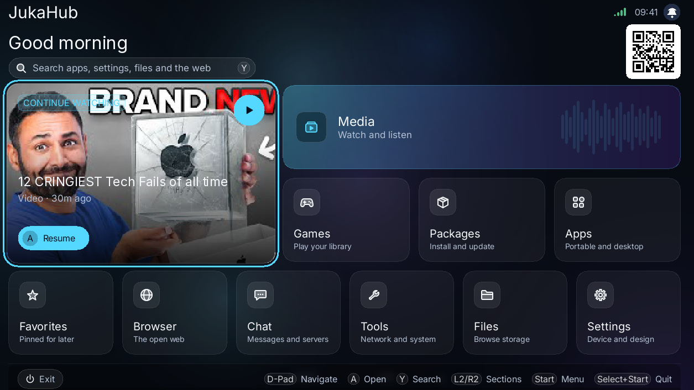
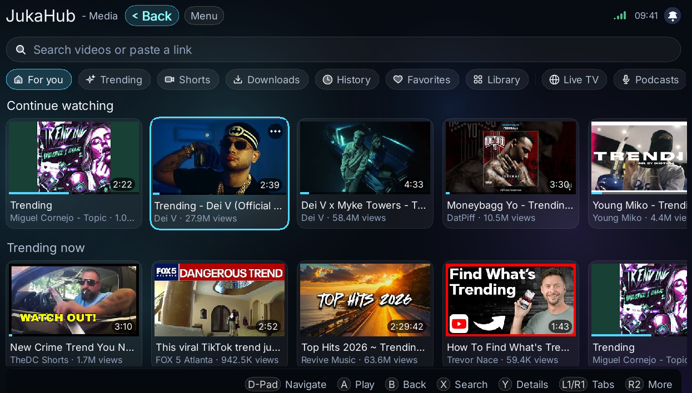
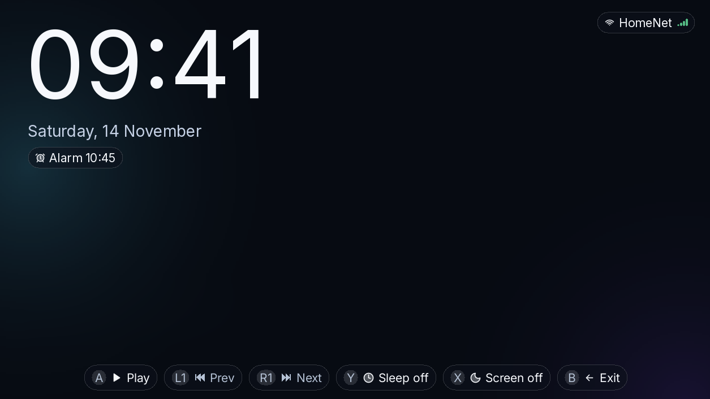
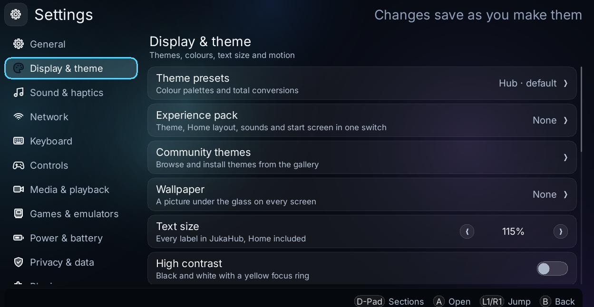
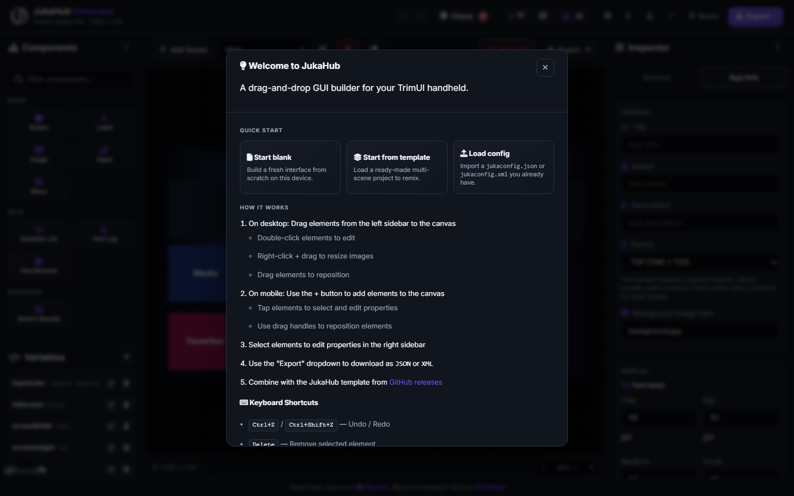
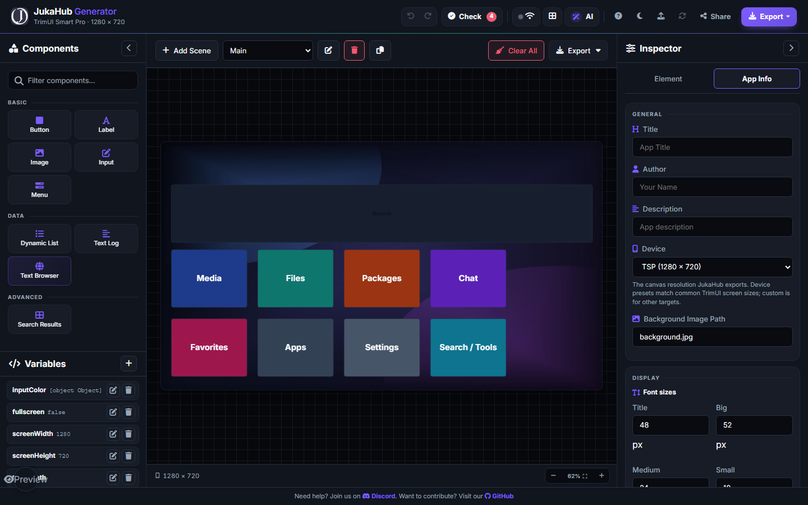
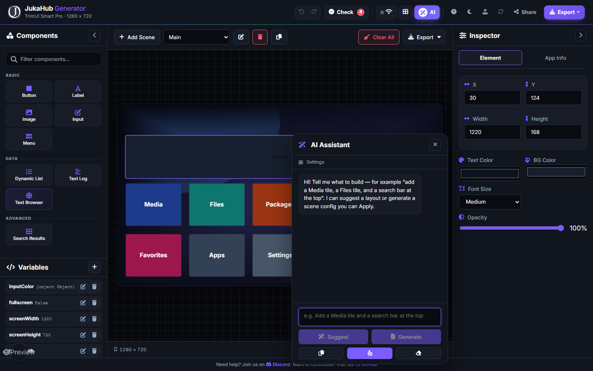
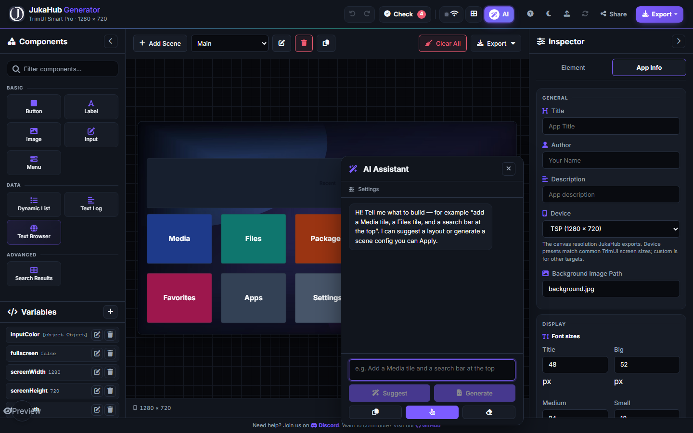
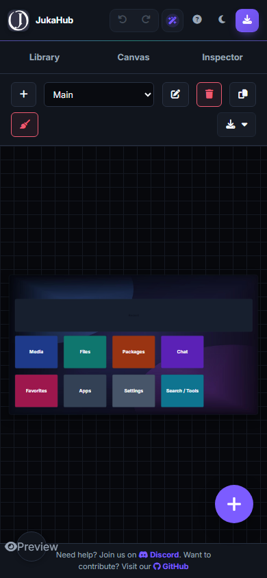

<p align="center"></p>

# JukaHub

[](https://github.com/jukaLang/JukaHubV2/actions/workflows/ci.yml)
[](https://generate.jukalang.com)
[](https://github.com/jukaLang/JukaHubV2/releases/latest)
[](https://go.dev/dl/)
[](https://www.libsdl.org/)
[](LICENSE)
[](https://api.scorecard.dev/projects/github.com/jukaLang/JukaHubV2)
[](https://discord.gg/R9qgJjh5jG)

<p align="center">
  
</p>

**Your TrimUI handheld as a complete media and gaming console: one folder on
the SD card, the stock OS untouched underneath.**

A media hub for the **TrimUI Smart Pro** — and the whole TrimUI line — with no
firmware swap and nothing to replace. **The shell your handheld should have
shipped with**: YouTube on the couch, your ROM library with box art and
save-resume, PS4/PS5 Remote Play anywhere your Wi-Fi reaches, LAN play in the
same room, a phone as your keyboard — every screen driven by the D-pad you already have.
It is one folder on the card, so installing it is always reversible.

Updates are signed and roll themselves back if a new build misbehaves, and
nothing is uploaded anywhere unless you switch it on. Ten minutes from download
to all of that: the walkthrough is [docs/TOUR.md](docs/TOUR.md).

[Download](https://github.com/jukaLang/JukaHubV2/releases/latest) ·
[Web builder](https://generate.jukalang.com) ·
[Discord](https://discord.gg/R9qgJjh5jG) ·
[Controls](docs/CONTROLS.md) ·
[Developer guide](docs/DEVELOPMENT.md) ·
[Dependencies](docs/DEPENDENCIES.md)

## Contents

**What it is** — [What it does](#one-app-the-whole-card) ·
[JukaHub and Juka](#jukahub-and-juka) · [Why JukaHub](#why-jukahub)

**Install and set up** — [Install](#install-on-a-trimui-smart-pro) ·
[First run](#first-run) · [Controls](#controls) ·
[Copy files from your PC](#copy-files-from-your-pc) ·
[SFTP](#browse-files-over-sftp) ·
[Phone as a keyboard](#use-your-phone-as-a-keyboard) ·
[Screen Share](#share-the-screen-on-a-tv-screen-share) · [Updating](#updating) ·
[Privacy](#privacy)

**When something goes wrong** — [Something is wrong?](#something-is-wrong) ·
[Other devices](#other-devices)

**Reference and contributing** — [Security](#security) · [Toolbox](#toolbox) ·
[Web builder](#build-a-screen-in-the-web-builder) ·
[Share and remix a design](#share-and-remix-a-design) ·
[Contributing](#contributing) · [Documentation](#documentation)

---

## One app, the whole card

JukaHub is one controller-first app for the whole card, running *on top of* the
firmware — not instead of it. Install, uninstall, repeat: it is a folder on the
SD card, and the stock launcher is one Select+Start hold away whenever you want
it back.

* **Watch** — YouTube search and trending, Shorts, saved favourites, podcasts
  with a subscription library, IPTV playlists, a local video player with
  subtitles, an EPUB/PDF reader, and a text web browser.
* **Play** — a console-by-console ROM library with box art, per-game launchers,
  play time, RetroAchievements progress, save-state auto-resume and LAN play
  (RetroArch netplay, hosted or joined from the library).
* **Keep** — save-folder snapshots with one-tap restore, SD-card health checks,
  battery health, and a Continue list built from what you actually used.
* **Connect** — a LAN watch party, PS4/PS5 Remote Play, sharing the screen —
  games too — to a browser on a TV or laptop, typing from a phone, and SFTP/FTP
  plus SSH file access.
* **Make it yours** — themes, animated GIF wallpapers, a liquid background that
  ripples as you move and the browser design builder, plus accessibility
  settings: text scaling, high-contrast and colour-blind palettes, button swaps
  and a one-handed chord.
* **Talk to it** — press Menu (F4 on a keyboard) and a glowing orb listens:
  say "open YouTube" or "volume 50", or ask Juka a question. It listens
  through the handheld's microphone or your phone's keyboard.
* **Hear it around you** — spatial audio places videos and music (and RetroArch
  games, through a filter JukaHub ships) around you on headphones, or widens the
  speakers.
* **Try Android games** — the APK Store reads the APKs on the card and says
  plainly which ones AndroidRT can try (experimental: nothing has been verified
  on a handheld yet).
* **Extend** — signed packages from a repository with rollback, and plugins.

Most of these have a page in the [documentation table](#documentation) below.

<table>
  <tr>
    <td width="50%" valign="top">
      
      <br>
      <b>Media</b> — YouTube with Continue watching and Trending rows;
      Shorts, Downloads, History, Favorites, Library, Live TV and Podcasts are
      tabs on the same screen.
    </td>
    <td width="50%" valign="top">
      
      <br>
      <b>Dock &amp; ambient</b> — the clock that takes over while charging or
      idle, with the next alarm, today's weather and new chat messages, and
      play, skip, a sleep timer and screen-off on the buttons.
    </td>
  </tr>
</table>

## JukaHub and Juka

The name is deliberate, and the relationship is easy to misread: **JukaHub is not
a Juka program, and the device needs no Juka runtime to run it.** The launcher is
Go + SDL2 — the one runtime the firmware already ships — because that is what a
handheld with no Python, no build tools and 1 GB of RAM can actually run well.

What it shares with the ecosystem is the data layer: every screen is a
`jukaconfig.json`, authored in the [web builder](https://generate.jukalang.com)
and loaded by the player, so a design moves between the browser and the card
without a rebuild or a recompile. The language itself, its packages and the rest
of the family live at [jukalang.com](https://jukalang.com) and
[github.com/jukaLang](https://github.com/jukaLang); this repository is the
handheld end of it, and the format both halves agree on is documented in
[docs/CONFIGURATION.md](docs/CONFIGURATION.md).

## Why JukaHub

Four things separate it from the other TrimUI frontends, and each one has a page
because it is a design decision rather than a feature bullet.

* **The interface is data.** Every screen is `jukaconfig.json` — elements,
  bounds, triggers and theme tokens — so a layout can be changed without
  touching Go. The [web builder](https://generate.jukalang.com) edits the same
  file the device reads; see [docs/CONFIGURATION.md](docs/CONFIGURATION.md).
* **Updates work like a package manager.** A signed repository, staged
  installs, SHA-256 *and* Ed25519 verification, a rollback copy and an
  interrupted-install recovery — not "download the zip and hope". See
  [docs/PACKAGES.md](docs/PACKAGES.md) and [Updating](#updating).
* **A fast, honest test suite.** The Go tests guard what would hurt users
  silently — saved data, config migration, security checks, the updater and the
  package installer — and run in seconds, so they get run. Visual changes are
  checked on screen, on Windows and then on the device.
* **Breadth without a second app.** Watch party, PS4/PS5 streaming, the video
  and music players, FTP/SFTP, plugins, the accessibility panel and opt-in
  telemetry all ship in the same folder, on top of the stock firmware.

What is still missing, and what deliberately cannot work on this hardware, is
listed honestly in the [engineering backlog](player/MODERNIZATION.md).

## Install on a TrimUI Smart Pro

Five steps, no firmware swap, works on the stock OS and on CrossMix. You need
the handheld, its SD card, and Wi-Fi.

1. Download **`JukaHub-Trimui.zip`** from
   [Releases](https://github.com/jukaLang/JukaHubV2/releases/latest).
2. Turn the device off and put the SD card in your computer.
3. On the card, open the **`Apps`** folder and create a folder named
   **`JukaHub`** inside it.
4. Extract **all files** from the download into `Apps/JukaHub`.
5. Put the card back in, power on, and open **Apps → JukaHub**.

When you are done the folder looks like this:

```text
SDCARD/Apps/JukaHub/
├── JukaHub            <- the application
├── launch.sh
├── config.json        <- the Apps-menu entry
├── jukaconfig.json    <- the interface
├── JukaPlayer.png     <- the icon in the Apps menu
├── Inter-Regular.ttf
└── background.jpg
```

That's the whole installation. There is nothing else to set up:

* the firmware already ships SDL2, so there are no extra libraries,
* no Python and no build tools are needed on the device,
* `yt-dlp` and `ffmpeg` download themselves on first launch (needs Wi-Fi; the
  first start takes a minute or two, later starts are instant).

If JukaHub does not appear in **Apps**, reboot the device — the stock launcher
only scans `Apps/` at boot. Also check that the folder is exactly
`Apps/JukaHub` and that `launch.sh` is inside it.

> **Here to build it, not just use it?** Clone to a running build in about five
> minutes with [docs/QUICK_START.md](docs/QUICK_START.md), pick up work labelled
> [`good first issue`](https://github.com/jukaLang/JukaHubV2/labels/good%20first%20issue),
> and read [Contributing](#contributing) for the rules that keep the suite green.

## First run

Home is a grid of tiles: **Continue**, **Media**, **Games**, **Packages**,
**Apps**, **Favorites**, **Browser**, **Chat**, **Tools**, **Files**,
**Settings**, plus **Exit** in the footer, under a search bar (**Y**) for apps,
settings, files and the web. The PS4/PS5 launcher tiles and the
phone-pairing QR sit just under the top bar on the right; the weather chip, the
clock and the notification bell are in the bar itself.

* **Media / Tube** — YouTube search and trending.
* **Music** — open any audio file from the browser and the player takes its
  folder: shuffle that visits each track once, repeat off/all/one, a play-next
  queue, favorites that survive a restart, 0.75×–2× speed, a sleep timer,
  synced `.lrc` lyrics and a full-screen spectrum. Playback continues while you
  browse; see [docs/MUSIC_PLAYER.md](docs/MUSIC_PLAYER.md) for the feature map
  and roadmap.
* **Offline music** — **Start → Tools → Downloads** saves a link as an m4a on
  the card:
  a queue with live progress and speed, pause/resume, per-row retry and the SD
  card's own usage bar. Saved tracks open in the audio player, so a downloaded
  album plays with Wi-Fi off; see [docs/CONTROLS.md](docs/CONTROLS.md#downloads).
* **Photos** — open PNG, JPG, BMP and WebP images from the file browser, then
  browse the folder with Left/Right and zoom with Up/Down. WebP box art decodes
  natively on the handheld, whose SDL_image links libwebp; a desktop runtime that
  ships an SDL2_image without libwebp detects that at startup and skips WebP
  files instead of showing a broken picture.
* **Dock & ambient** — while charging (after 45 quiet seconds) or idle, the
  screen becomes a dock display: a large clock, today's weather, the track that
  is playing and a slideshow from your Photos folder. Y arms a sleep timer, X
  blanks the panel while audio keeps playing, and an alarm wakes it. Open it by
  hand from **Start → Ambient**; see [docs/AMBIENT.md](docs/AMBIENT.md).
* **Favorites** — save links and reopen them later.
* **Apps** — a tile launcher for the other apps on the card, plus built-in
  extras (JukaLand, Weather, and **Browser**, a text web browser with GitHub
  issue quick links; see [docs/BROWSER.md](docs/BROWSER.md)). Every installed
  app is drawn with its own icon — the `icon.png`/`config.json` art of an app
  folder, an image stored next to the program, or the icon Windows reports for
  a shortcut — and falls back to a coloured initial when it has none.
* **Wi-Fi** — a first-party network picker: scan, join with the on-screen
  keyboard, reconnect saved networks without retyping the password, disconnect
  and forget. Open it from **Quick Settings → Wi-Fi Networks** or **Hardware →
  Wi-Fi**; see [docs/WIFI.md](docs/WIFI.md).
* **Settings** — playback resolution, weather and 47 colour themes
  (Dark, Light, High Contrast, Anime, Cute, Girly, Fallout, Matrix and more).
  **Display & theme** also holds the wallpaper — a GIF plays, unless
  **Animate wallpaper** is off or Battery Saver is on — and **Liquid
  background**, which turns the backdrop under the glass into water that
  ripples where the focus lands and stirs with the sticks.
  **Smart Widgets** (from General) holds the settings that react to the device
  on their own: battery saver, which drops to the slowest cadence, stops UI
  motion and switches to the OLED theme below 20% until it is charged again;
  light & dark by time of day (a day theme and a night theme that switch at
  times you choose, also under Display & theme); and start at login, which a
  TrimUI switches on at its first start and a desktop leaves off. A start with
  the device plays a full boot — the logo comes alive and Home builds itself
  card by card — and **General → Boot logo** puts the JukaHub logo into the
  firmware's own power-on screen ([docs/BOOT.md](docs/BOOT.md)).

  
* **Game Profiles** — launch Windows games through Box64/Wine, native
  binaries and scripts. Profiles live in `Apps/JukaHub/data/game-profiles`;
  see [docs/GAME_PROFILES.md](docs/GAME_PROFILES.md) for the format and the
  import/export workflow.
* **Smart Pro Compatibility** — per-game community reports, an honest
  hardware tier when nobody has reported a title yet, one-press boost plans for
  N64/Dreamcast/PSP, and a manager for multiple libretro core builds. **U**
  (or **L1**) on the Core-builds tab checks the libretro aarch64 buildbot and
  pools newer builds of the installed cores, checksum-checked and checked to
  load on this firmware; the daily **Emulator updates** pass installs them by
  itself (keeping the replaced build for a one-press roll back) unless set to
  Notify me or Off, and keeps JukaHub's own PPSSPP, hakuX and the downloaded
  runtimes current the same way — on a PC, the emulators JukaHub installed and
  its RetroArch's cores. Reports
  and core pools live in `Apps/JukaHub/data/performance`; see
  [docs/COMPATIBILITY.md](docs/COMPATIBILITY.md).
* **Windows Apps** — scan for `.exe` files and launch basic Windows programs
  through Wine. On TrimUI's no-X11 firmware it can route through WestonPack's
  DRM/KMS compositor instead of failing on a missing display. If DXVK is
  installed beside Wine and a Vulkan loader is present, Direct3D DLL overrides
  are enabled automatically; see [docs/WINDOWS_APPS.md](docs/WINDOWS_APPS.md)
  for the runtime setup.
* **Games Library** — **Emulators → Games Library** browses `Roms/<system>/`
  console by console, shows the box art downloaded for each title, and launches
  the game with the emulator that owns its system. Drop a short clip in
  `data/game-snaps/` and the preview box plays it while the focus rests on that
  game. Every launch is recorded, so
  the **Continue** row at the top resumes the last game in one press. **X** on a
  game opens **LAN Play**: host it, or join another device over Wi-Fi, so link
  cable titles like Mario Kart and Four Swords play without a cable. **Tools →
  Disc helpers** fills in the cue sheets and multi-disc playlists that
  PlayStation and Sega CD rips need, without touching an existing file. See
  [docs/GAME_LIBRARY.md](docs/GAME_LIBRARY.md).
* **PortMaster Ports** — install PortMaster from the Emulators screen and launch
  the ports it manages without leaving JukaHub. Installed launchers are read
  from `Ports/` and the older `Roms/Ports` locations; see
  [docs/PORTMASTER.md](docs/PORTMASTER.md).
* **Save Manager** — snapshot every emulator save folder into a versioned copy,
  restore one with a safety snapshot first, prepare the folders for Syncthing
  and export a phone resume bundle. Snapshots are plain files on the card, so
  they work without JukaHub; see [docs/SAVE_MANAGER.md](docs/SAVE_MANAGER.md).
* **Curation Hub** — a device-specific layer over the Store: an essentials
  checklist for a new card, shareable theme + text-size profiles tuned per
  panel, and compatibility votes for games and PortMaster titles. It works
  offline; see [docs/CURATION.md](docs/CURATION.md).
* **Accessibility** — global text scaling (85–145%), a high-contrast palette,
  three colour-blind-safe palettes and a system-wide A/B / X/Y controller
  remap, all from one panel in the Start menu; see
  [docs/ACCESSIBILITY.md](docs/ACCESSIBILITY.md).
* **PS Remote Play** — JukaHub's own PS4/PS5 client, with no Python launcher
  and no dependency on a separate Chiaki-ng install. It scans the LAN, pairs
  over the LAN (**Link Device** PIN; PS5 also needs the PSN Account-ID),
  remembers consoles and quality, and streams through the bundled
  `chiaki-stream` native helper. PS4 pairing is pure Go, so a PS4 works even
  before the helper is present. **PS4** and **PS5** tiles in the home header,
  left of the phone-pairing QR, open the panel in one press and are reachable
  with the D-pad (`Up` from the card beneath them) and **A**. JukaHub hands the
  screen to the helper and closes while it runs; the stock menu returns when the
  stream ends. See [docs/REMOTE_PLAY.md](docs/REMOTE_PLAY.md).
* **Smart home** — **Start → Smart Home** drives Home Assistant entities,
  mirrors every toggle to MQTT, shows the Pi-hole, router and Tailscale state,
  and connects or disconnects the tunnel. WireGuard is status-only because
  `wg-quick` needs root. See [docs/SMART_HOME.md](docs/SMART_HOME.md).
* **Logs** — view or export the app log if something misbehaves.
* **Tools** — this device's IP address, a built-in FTP server for quick file
  drops over Wi-Fi, an SSH/SFTP server for browsing the file system from a PC
  (also under **Tools → FTP & IP**), the phone companion that turns a phone
  into a keyboard, remote and file drop, **Screen Share** to show the screen,
  games too, live in a browser on a TV or laptop, and **Community & support** for the
  changelog, bug reports and the anonymous-diagnostics switch. **Power tools**
  adds a gateway or clipboard-host port scan, ping/traceroute, DNS and Wi-Fi
  checks, a hex/JSON/log viewer, clipboard-saved script buttons, rsync and Syncthing checks,
  jukauser.json snapshots with diff/rollback, and a read/write benchmark
  board.

Turn Wi-Fi on in Quick Settings, then join a network from **Quick Settings →
Wi-Fi Networks** before using YouTube or weather. Your settings are stored in
`Apps/JukaHub/jukauser.json` and survive updates.

## Controls

D-pad moves, **A** confirms, **B** goes back, **X** and **Y** are the secondary
and tertiary actions, **L1/R1** move between sections and pages, **Start** opens
the Start menu — scenes in one group, games, tools and device actions in the
others, so switching screen or taking a screenshot is two presses away.

To leave the app, hold **Select + Start** together. JukaHub saves, shows a
teardown card while it stops games, servers and caches, then returns to the
stock launcher — this works from any screen, including while a video is playing
or a panel is open.

Press **F1** on a desktop build for the full list as an in-app overlay. Per-screen
tables (Live TV, video player, on-screen keyboard, music player, Pomodoro,
alarm, calculator, terminal, JukaLand, desktop keys) are in
**[docs/CONTROLS.md](docs/CONTROLS.md)**.

## Copy files from your PC

1. Connect the handheld to the same Wi-Fi as your PC.
2. Open **Tools** and note the **IP address** (press A to copy it).
3. Start the **FTP server** (**Tools → Network tools**). The panel shows the
   address to type, such as `ftp://192.168.1.42:2121`, the user name `juka`
   and a password made up for this start.
4. On your PC, paste that address into Explorer/Finder (or any FTP client),
   sign in, and drop files into one of the folders it shows: `Roms`, `BIOS`,
   `Saves`, your media folders and JukaHub's downloads. The rest of the card —
   the apps, emulator scripts and system files — is not shared (on Windows the
   share is a `shared` folder next to the app, so your settings and saved
   logins are never exposed). `Roms/Ports` and the folders of game profiles
   hold programs the device runs, so FTP can read them but not change them;
   use SFTP for those.

A wrong password costs a pause, three end the connection, and ten from one
address lock it out for ten minutes. FTP is not encrypted, so on a network you
do not trust use SFTP below. Both servers switch themselves off after 15
minutes nobody uses them, and when the handheld joins another network; the
panel lists who is connected while they run.

## Browse files over SFTP

For `scp`, backup scripts and editors, **Tools → SSH / SFTP** starts a server
that only speaks SFTP. The panel shows an address such as
`sftp://juka@192.168.1.42:2222` and a one-time password for the `juka` account;
connect with WinSCP, FileZilla, Cyberduck, Finder or the `sftp` command line.
(Windows Explorer only speaks FTP, so use the server above or install an SFTP
client.)

Unlike FTP this is encrypted: the password is random and regenerated every
start, guesses are limited, and shell commands, port forwarding and tunnels are
refused. It shares the SD card (your home folder on a computer); the whole file
system only after **Share whole system…** on its panel is pressed twice, for
that run of JukaHub. Paths cannot escape the root, including through symlinks,
and the host key is saved once in the app data folder. On the handheld the
SFTP tile opens its panel first (that is where **Share whole system…** is);
press **Start** there. Press **A** on the row (or run `ssh off`) to stop it.

The password is shown on the device only and is never written to
`jukauser.json` or the log. For unattended access, put your public key in
`Apps/JukaHub/data/ssh_authorized_keys` (OpenSSH format). Advanced settings:

| Variable | Effect |
|----------|--------|
| `JUKAHUB_SSH_PORT` | Port to listen on (default `2222`), or set `ssh_port` in the config |
| `JUKAHUB_SSH_ROOT` | Folder to expose instead of the SD card |
| `JUKAHUB_SSH_FULL_ROOT=1` | Expose the whole file system on every start (Linux); or set `ssh_full_root` in the config |
| `JUKAHUB_SSH_READONLY=1` | Refuse every upload, rename and delete; or set `ssh_readonly` in the config |
| `JUKAHUB_COMPANION_PORT` | Port for the phone companion page (default `8317`) |

## Use your phone as a keyboard

Typing a search on a D-pad is slow. **Tools → Phone companion** shows a QR
code; scan it with your phone camera (phone and handheld on the same Wi-Fi) and
the phone opens a small page with:

* **The handheld's screen**, pinned at the top while everything below it
  scrolls. It refreshes a moment after each press, text, link or upload;
  **Live** keeps it moving and **Hide screen** folds it away.
* **Type** — a text box whose contents appear in whichever field has focus,
  with an optional Enter after each send.
* **Remote** — D-pad, A/B/X/Y, Start, Back and the shoulder buttons.
* **Send a link** — paste a YouTube, direct-video or stream link and it starts
  playing on the handheld.
* **Send a file** — uploads land in the `PhoneDrop` folder of the shared folder
  (the same one FTP publishes), ready for the file browser or player.
* **Groq API key** — paste the key from console.groq.com instead of typing 56
  characters on the handheld. It is checked with Groq, saved for voice typing,
  voice commands and the Juka chat, and never shown again (the page only
  learns its last four characters).
* **PlayStation Remote Play** — save the PSN Account-ID that pairing a PS5 (or
  a PS4 on firmware 7 or newer) needs: paste it, the long account number, or
  the address of Sony's *redirect* page, or tap **Sign in to get it** for
  Sony's sign-in. The card also follows Remote Play's own download on the
  handheld, with **Download now** when it is missing (the page only learns the
  Account-ID's first and last characters).

The QR code carries a fresh six-digit PIN, so nothing has to be typed on the
device. The server runs in the background for the whole session, and **Y**
issues a new PIN on the spot (which also invalidates every companion link
already shared; a Screen Share link has its own token and keeps working).
`JUKAHUB_COMPANION_PORT` overrides the port (default `8317`).

## Share the screen on a TV (Screen Share)

The Smart Pro has no HDMI port, so JukaHub sends its screen to a browser
instead. **Start → Tools → Screen Share** (search finds it as *screen share*,
*cast*, *tv* or *hdmi*) shows a link and a QR code. Open the link on a smart TV,
laptop, tablet or phone on the same Wi-Fi — or open it on a laptop and cast that
tab to a TV — and the handheld's screen appears live, games included, with no
app to install: the stream is plain MJPEG in a web page.

* **A / Enter** on *Share* starts or stops sharing. It is off by default; while
  it is off the link's page waits, and it starts by itself when you switch
  sharing on.
* **Quality**: Smooth (640 px, 20 fps; the handheld's default), Balanced
  (960 px, 15 fps; a PC's) or Sharp (full size, 10 fps); **Left / Right** change
  it. The handheld captures its menus at most about twelve times a second
  (fewer when the GPU is slow to hand a frame back), and a screen that is not
  changing is re-sent once a second instead of at the frame rate.
* **Games too** (handheld): JukaHub stops drawing while a game runs, so the
  picture then comes from the screen's framebuffer — through the bundled ffmpeg
  when it is installed, otherwise JukaHub's own reader at up to 8 fps and
  640 px. Switch it off and viewers see a pause card while you play.
* On the viewer page, **F** or a double-click (double-tap) toggles full screen
  and **M** cycles Fit / Fill / Pixel-perfect; the controls hide after three
  idle seconds. Add `&tv=1` to the link for a TV browser: no buttons, just the
  picture. A browser that cannot show the stream falls back to single frames.
* A red **LIVE** pill at the top of the handheld's screen shows while anyone
  watches; it never appears in the stream or in screenshots.
* The link keeps working across restarts until you make a new one: **Y** in the
  panel does that, and the old link stops at once. The Phone Companion's PIN is
  not changed.
* Up to six browsers can watch at once (streams and single-frame viewers
  together). Sound stays on the handheld (or its Bluetooth headphones).
* In safe mode, or with no network, the panel says why and sharing stays off.

The link is view-only: it cannot press buttons, type or upload, and the
phone-pairing code (Home's header QR, the pairing card, and the panel's own code
and link) is painted over in the shared picture. Everything else on screen is
shown — including what you type — so share the link only with people you trust,
and switch sharing off when you are done.

## Build a screen in the web builder

The [web builder](https://generate.jukalang.com) lays out a handheld screen
without writing code. Start from the welcome dialog, then:

1. Pick **Start blank**, **Start from template**, or **Load config** to import
   an existing `jukaconfig.json` or `jukaconfig.xml`.
2. Drag Button, Label, Image, Input, Menu and the other components from the
   left sidebar onto the canvas.
3. Select an element to edit its properties in the Inspector.
4. Use **Check** to catch problems, then **Export** as JSON or XML.









On a narrow screen the builder switches to Library, Canvas and Inspector tabs:



### Push a design to the handheld

**Live Builder** sends the design to a running JukaHub over Wi-Fi and reloads it
in place. On the handheld, turn it on in **Settings → Network → Live Builder**;
the row shows the address and the six-digit pairing code. In the builder open
**Device**, enter both and press **Push to device**. Open the builder from a
copy on `http://localhost`: a browser does not let an HTTPS page reach a plain
HTTP device. The receiver switches itself off after 30 minutes without use, and
a design that can run programs or change protected settings waits until you
approve it on the device — see
[SECURITY.md](SECURITY.md#live-builder-the-web-builders-receiver).

| Variable | Effect |
|----------|--------|
| `JUKAHUB_LIVE_BUILDER=0` / `1` | Never start the receiver / start it with JukaHub, whatever the Settings switch says |
| `JUKAHUB_LIVE_LAN=1` | On a PC, listen on the network instead of this computer only (or set `liveBuilderLAN`) |
| `JUKAHUB_LIVE_PORT` | Port to listen on (default `8422`; a busy port falls back to a free one, shown in Settings) |
| `JUKAHUB_LIVE_ORIGINS` | Extra builder origins allowed to call the device, comma-separated (a self-hosted builder) |

## Share and remix a design

In the [web builder](https://generate.jukalang.com), **Share** turns the current
theme, fonts and layout into one link. Nothing is uploaded: the design is
compressed into the link itself, and account keys, tokens and recent activity
are stripped first. Opening the link shows **Remix**, which loads a fresh copy
into that person's workspace; their existing design is only replaced when they
choose it. Very large projects may exceed chat-app URL limits — in that case
use **Export → JSON** and send the file.

## Updating

JukaHub updates itself. On launch it checks the latest release on GitHub and,
when a newer build exists, offers it as a **download icon in the home header**,
immediately left of the weather text. Select it with the D-pad (the arrows step
onto it from the weather chip) and press **A**, or click it: one press downloads
the archive for the platform (`JukaHub-Windows.zip` on Windows,
`JukaHub-Trimui.zip` on TrimUI), checks its SHA-256 against the digest GitHub
publishes for that asset (a truncated or swapped archive is rejected before it
is unpacked) and, when the release ships a signed `release.json`, verifies that
signature with the same Ed25519 key as the Patch repository — so a compromised
release account is not enough to install a build. It then unpacks the archive, replaces the app files
and restarts. Progress shows in the install bar over whatever screen is open, so
there is no menu to walk through. Your `jukauser.json` settings, favorites and
media are untouched, and an interrupted update is rolled back automatically at
next launch. The once-per-launch "update available" prompt installs the same
way.

On the handheld the restart happens in place: `launch.sh` runs the new build
itself and keeps the firmware supervisors paused, so the stock launcher never
comes back underneath JukaHub. A build installed before this handover still
relaunches the old way once — that update replaces `launch.sh` with the new one,
and every update after it restarts cleanly.

After the restart, **What's new** opens once with that release's notes (the
notes are cached before the swap, so it also works offline). You can reopen it
any time from **Tools → Community & support**. The version line shows the
release build date, e.g. `v0.4.0 · 2026-10-17`, so you can tell which build is
installed. **Tools → Patch → Check for updates** runs the same check manually.
Set `JUKAHUB_NO_AUTOUPDATE=1` to disable automatic updates, or extract a release
archive over `Apps/JukaHub` by hand.

## Privacy

Anonymous diagnostics are **off by default**. The switch is under **Tools →
Community & support**, and the app never sends anything unless you turn it on.
When enabled, the only data is the build/version, device model, platform and
OS/architecture — plus a crash count when the app panics. There is no install
ID, account, filename, config value or usage history. **Report a bug** sends a
redacted report straight from the device after you review it; it becomes a
public GitHub issue, not under your name ([docs/BUG_REPORTS.md](docs/BUG_REPORTS.md)).

To uninstall, delete the `Apps/JukaHub` folder.

## Something is wrong?

Logs are on the SD card, so you can read them on a PC without SSH.

| Problem | What to do |
|---------|-----------|
| Not in the Apps menu | Reboot. Check the folder is `Apps/JukaHub` and contains `launch.sh`. |
| Black screen or closes at once | Send `Apps/JukaHub/errors.txt` — the launcher's log — and the newest `crash-*.txt` next to it (on Windows in `%LOCALAPPDATA%\JukaHub\logs`). |
| A plugin, a setting or a bad update broke startup | Hold **L + R + Start** (Ctrl + Alt + R on a keyboard) while JukaHub starts: safe mode plus a recovery card (previous version, last good settings, reset settings). Three failed starts in a row start safe mode by themselves. Or create an empty `safe-mode.flag` next to the app (or launch with `--safe-mode`). See [docs/RECOVERY.md](docs/RECOVERY.md). |
| Screen blinks between the stock menu and JukaHub after an update | Both UIs are drawing at once: the launcher on the card is older than the app. Update once more, or copy `launch.sh` from the release archive over `Apps/JukaHub/launch.sh`, then reboot. |
| YouTube search fails | Check Wi-Fi; open **Logs** from the Start menu for the app's own log. |
| A video goes black for a second, then says it is downloading | The stream would not open, so JukaHub downloads the video and plays it from the card instead (**B** cancels). If that fails too, the message says why; `errors.txt` has a line starting `decoder for` with ffmpeg's reason. |
| Video stutters | Settings → playback resolution → try `480` or `360`. |
| Text shows as boxes | `Inter-Regular.ttf` is missing from `Apps/JukaHub`. |

`Apps/JukaHub/errors.txt` is the launcher log. For the app's own log, open
**Logs → Export** on the device; it writes `Apps/JukaHub/logs.txt`. If you need
help, **Tools → Community & support → Report a bug** sends a report with
redacted diagnostics straight from the device and shows the issue number it
became; you can still attach a log or ask on [Discord](https://discord.gg/R9qgJjh5jG).

## Other devices

The same package is built for **TrimUI Smart Pro S**, **TrimUI Brick**,
**Brick Pro** and **TrimUI Hammer** (pick the matching file on the Releases
page). JukaHub detects the panel and picks its canvas automatically: 1280×720
on the Smart Pro and Smart Pro S, and a compact 960×720 canvas scaled to the
1024×768 4:3 Brick, Brick Pro and Hammer screens. Windows builds are for trying
JukaHub on a PC.

## Security

The short version — [SECURITY.md](SECURITY.md) has the threat model, the key
management and the honest limits, and **Tools → Security & trust** shows the live
state on the device without a PC.

- **Secrets are encrypted, not hidden in a shell variable.** API keys and tokens
  in `jukaconfig.json` are AES-256-GCM with per-value nonces; set your own key
  with `JUKAHUB_CRYPTO_KEY`, and the posture view tells you when the built-in
  default is still in use. `./JukaHub -set-secret <field>` reads the value from
  stdin so it never lands in shell history.
- **Updates and packages are signed.** The Patch repository index is
  Ed25519-signed with the public key compiled into the binary, and every archive
  is SHA-256-checked against that index before it is installed — a rollback copy
  is kept. HTTPS alone is never treated as authenticity.
- **Downloads come from a curated allowlist.** Helper tools and the
  [Toolbox](#toolbox) resolve only from repos listed in code, match release
  assets on stable name parts, skip checksum side-cars, and stream through the
  same size-capped downloader. Running one is a direct exec, never a shell.
- **The LAN servers are opt-in and visible.** FTP/SFTP start only when you press
  the row, SFTP generates its own password and prints a host-key fingerprint, and
  the posture view names whatever is listening.
- **No telemetry unless you ask.** One boot/crash ping, off by default, and the
  payload is limited to build and device facts.

## Toolbox

**Tools → Toolbox** installs popular command-line tools on demand and runs them
with visible output: `rclone` (cloud/SSH sync), `jq` (JSON), `ripgrep` and `fd`
(search), `pandoc` (document conversion) and `age` (encryption). **A** installs
the first time and runs afterwards, **X** opens the on-screen keyboard for
arguments, **Y** copies the installed path. Installed tools also work from
Power tools → Script snippets, so one press can turn a tool into a button.

Three network scanners sit at the end of the catalog — `naabu` (open ports),
`httpx` (which hosts answer HTTP) and `dnsx` (DNS records) — for looking at your
own LAN. They are the only entries that send traffic to another machine, so the
first run of any of them asks once, and the answer is remembered. See
[Toolbox → Network scanning](docs/TOOLBOX.md#network-scanning).

Installers are fetched from each project's own GitHub releases; nothing is
bundled and nothing is uploaded. What the toolbox does and does not verify is in
[SECURITY.md](SECURITY.md#toolbox-and-helper-tool-downloads).

## Contributing

Start with the [engineering backlog](player/MODERNIZATION.md): it is the one
task list for the player, the builder and AndroidRT, with priorities, the files
to read, and what "done" means for each task — including the checks that still
need a device. Small, well-scoped work is the best way in: issues labelled
[`good first issue`](https://github.com/jukaLang/JukaHubV2/labels/good%20first%20issue).
Setup, test commands and commit rules are in [CONTRIBUTING.md](CONTRIBUTING.md).
Questions and feature talk happen on
[Discord](https://discord.gg/R9qgJjh5jG) and in
[Discussions](https://github.com/jukaLang/JukaHubV2/discussions); support
paths are listed in [SUPPORT.md](SUPPORT.md).

The app screenshots in this README use stand-in data: the clock, date, alarm,
network name and pairing address are made up and the weather is left out.
`JukaHub --screenshot-tour ../screenshots`, run from `player/`, retakes all
four the same way, with controller hints; see
[Screenshots](docs/DEVELOPMENT.md#screenshots) for what it hides.

## Documentation

| Page | Covers |
|------|--------|
| [The ten-minute tour](docs/TOUR.md) | what the app feels like, from a cold SD card to Continue, in one story |
| [Quick start](docs/QUICK_START.md) | the five-minute path to a clone that builds, runs and checks |
| [Controls](docs/CONTROLS.md) | every button and key, screen by screen |
| [Configuration](docs/CONFIGURATION.md) | `jukaconfig.json`, variables, elements, all triggers |
| [Building](docs/BUILDING.md) | Windows/Linux/ARM64 builds, SD-card packaging, releases, CI |
| [Windows Apps](docs/WINDOWS_APPS.md) | Wine, Box64, WestonPack and the no-X11 display bridge |
| [Android and the APK Store](docs/ANDROID.md) | the APK Store's verdicts on the APKs you have, AndroidPak/AndroidRT for native Android games (experimental), Waydroid installs, and what cannot run and why |
| [PS Remote Play](docs/REMOTE_PLAY.md) | the built-in PS4/PS5 client, pairing, quality profiles and troubleshooting |
| [Accessibility](docs/ACCESSIBILITY.md) | text scaling, high-contrast and colour-blind palettes, controller remap |
| [Voice command](docs/VOICE.md) | the voice orb (Menu, or F4) and saying what to open — through the handheld's microphone or your phone's keyboard — what it understands, and how it finds the microphone |
| [Spatial audio](docs/SPATIAL_AUDIO.md) | virtual surround on headphones, wider stereo on the speakers, and RetroArch games through a filter JukaHub ships |
| [Theme files](docs/THEMES.md) | the complete theme JSON schema and the shared glass rules |
| [Smart home](docs/SMART_HOME.md) | Home Assistant, the MQTT toggle mirror, Pi-hole, router, Tailscale and WireGuard |
| [Device tuning](docs/DEVICE_TUNING.md) | PPSSPP stick calibration, power profiles per launch, port audio, 32-bit port flags |
| [Recovery](docs/RECOVERY.md) | low-battery save/suspend, the recovery chord, SD-card health |
| [Wi-Fi](docs/WIFI.md) | the network picker: scanning, joining, saved networks, troubleshooting |
| [VPN](docs/VPN.md) | WireGuard: importing a configuration (card, Files or phone), what goes through the tunnel, how it works on the handheld and on Windows |
| [Games Library](docs/GAME_LIBRARY.md) | console-by-console ROM browser, box art, launcher resolution, Continue list |
| [Save Manager](docs/SAVE_MANAGER.md) | snapshots of emulator save folders, restore, Syncthing setup, phone resume bundle |
| [Recordings](docs/RECORDINGS.md) | captures the emulator writes: one folder for both sides, listed and playable, and what an in-game overlay cannot do |
| [Memory scanner](docs/MEMORY.md) | RAM search and edit for a running game: scan, narrow, write, and what it cannot do |
| [Controller test](docs/CONTROLLER_TEST.md) | raw stick values, drift verdicts and a button check for a drifting pad |
| [Time-lapse](docs/TIMELAPSE.md) | one frame every few seconds of a playthrough, assembled into a short mp4 on exit |
| [Curation Hub](docs/CURATION.md) | essentials checklist, UI/theme profiles, compatibility votes, the optional community feed |
| [Dock & ambient](docs/AMBIENT.md) | the charging/idle clock, weather, now-playing and photo display, sleep timer, screen-off audio |
| [Packages](docs/PACKAGES.md) | the package format and the Patch package manager |
| [Toolbox](docs/TOOLBOX.md) | installing rclone, jq, ripgrep, fd, pandoc and age plus the naabu/httpx/dnsx scanners, running them with arguments, the one-time authorization prompt, what is and is not verified |
| [Plugins](docs/PLUGINS.md) | plugin manifests and the script execution contract |
| [Engineering backlog](player/MODERNIZATION.md) | every open task with priority, files and acceptance criteria; the hardware checks; the ideas parking lot |
| [UX review](docs/UX_REVIEW.md) | the November 2026 design critique: principles and per-screen findings |
| [Developer guide](docs/DEVELOPMENT.md) | architecture, design system, key files |
| [Architecture](docs/ARCHITECTURE.md) | the three runtimes (player, builder, patch repo), where a change lands |
| [Contributing](CONTRIBUTING.md) | local setup, tests, what to commit |
| [Code style](docs/STYLE.md) | naming, comments, config keys, the device budget, test expectations |
| [Checkpoints design](docs/CHECKPOINTS.md) | the quick-switch/save-slot milestone: options, constraints, phases (not implemented) |
| [TrimUI packaging](player/trimui/README.md) | device package, install and troubleshooting notes |
| [Security](SECURITY.md) | threat model, secret storage, signed updates, tool downloads, the in-app posture view |

## License and thanks

AGPL-3.0 — see [LICENSE](LICENSE).

Thanks to Nevrdid for finding and documenting bugs, Arthur Gregorio for Go
guidance, StarDrive and DigestPrism for supporting the app, @Dio for
contributions to improving key security, and everyone in the Juka Discord for
making it possible.
