<p align="center"></p>

# JukaHub

[](https://github.com/jukaLang/JukaHubV2/actions/workflows/ci.yml)
[](https://generate.jukalang.com)
[](https://github.com/jukaLang/JukaHubV2/releases/latest)
[](https://go.dev/dl/)
[](https://www.libsdl.org/)
[](LICENSE)
[](https://api.scorecard.dev/projects/github.com/jukaLang/JukaHubV2)
[](https://discord.gg/R9qgJjh5jG)

**A media hub and games console for your TrimUI handheld — one folder on the SD
card, on top of the stock firmware.**

YouTube on the couch, your ROM library with box art and save-resume, PS4/PS5
Remote Play anywhere your Wi-Fi reaches, LAN play in the same room, and your
phone as a keyboard — every screen driven by the D-pad you already have.
Nothing is flashed and nothing is replaced, so deleting one folder puts the
device back exactly as it was.

**[Download](https://github.com/jukaLang/JukaHubV2/releases/latest)** ·
**[The ten-minute tour](docs/TOUR.md)** ·
[Web builder](https://generate.jukalang.com) ·
[Controls](docs/CONTROLS.md) ·
[Discord](https://discord.gg/R9qgJjh5jG)

<p align="center">
  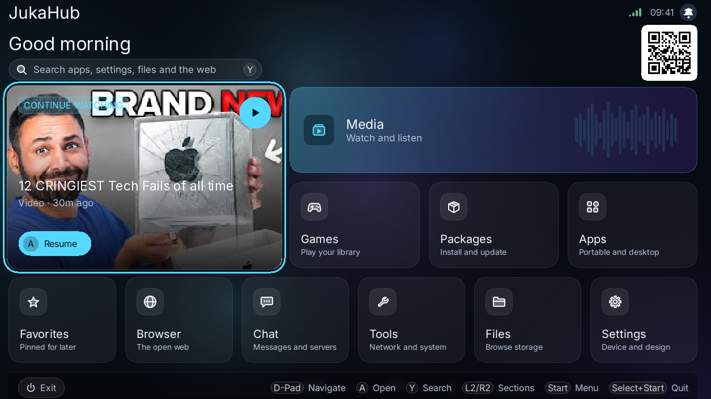
</p>

## What is JukaHub?

JukaHub is one controller-first app that sits on top of the firmware, not
instead of it. It is a media player, a game library, a remote-play client and a
toolbox in a single folder on the card, and the stock launcher is one
Select+Start hold away whenever you want it back.

- **Runs on** — TrimUI Smart Pro, Smart Pro S, Brick, Brick Pro and Hammer,
  plus a Windows PC if you want to try it out.
- **Installed as** — one folder, `Apps/JukaHub`, on the SD card.
- **Changes to the firmware** — none. Uninstall by deleting the folder.
- **Needs on the device** — nothing extra: no Python, no build tools, no SDL2
  download (the firmware already ships it).
- **Needs once** — Wi-Fi on the first start, to fetch its two helper tools.
- **Updates** — in-app, signed and checksum-checked; a bad build rolls back.

> **The name.** JukaHub is not a Juka program and needs no Juka runtime — the
> launcher is Go + SDL2, the one runtime the firmware already ships. What it
> shares with the rest of the family is the data layer: every screen is a
> `jukaconfig.json`, authored in the [web builder](https://generate.jukalang.com)
> and loaded by the player. See
> [docs/CONFIGURATION.md](docs/CONFIGURATION.md) and
> [jukalang.com](https://jukalang.com).

## Put it on your handheld

Five steps, about five minutes, no firmware swap. It works on the stock OS and
on CrossMix.

**You need:** the handheld, its SD card, a computer with an SD card reader, and
Wi-Fi for the first start.

<p align="center">
  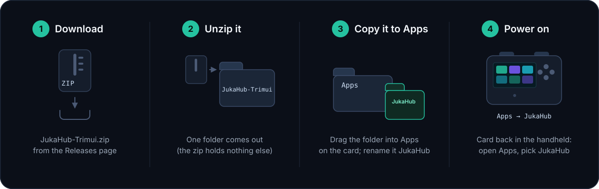
</p>

1. **Download `JukaHub-Trimui.zip`** from
   [Releases](https://github.com/jukaLang/JukaHubV2/releases/latest).
2. **Turn the handheld off** and put its SD card in your computer.
3. **Unzip the download.** It contains one folder, `JukaHub-Trimui`.
4. **Drag that folder into the card's `Apps` folder.** Renaming it to `JukaHub`
   is optional — the app runs from either name, and the Apps menu takes its
   label from `config.json`.
5. **Put the card back, power on, open Apps → JukaHub.**

That is the whole installation. Keep the folder whole: `launch.sh` and the
`JukaHub` program must sit **directly inside** it, not one level deeper. If
JukaHub does not appear in **Apps**, reboot — the stock launcher only scans
`Apps/` at boot — and check the folder name and contents again.

**On the first start** JukaHub downloads `yt-dlp` and `ffmpeg` into the folder
(a minute or two, once ever; it needs Wi-Fi). Later starts are instant, and
everything works offline after that except the things that need the network,
like YouTube and weather.

### On the device

These two are not renders: they were captured from the screen of a real
TrimUI Smart Pro, with the handheld's own status row on top.

<table>
  <tr>
    <td width="50%" valign="top">
      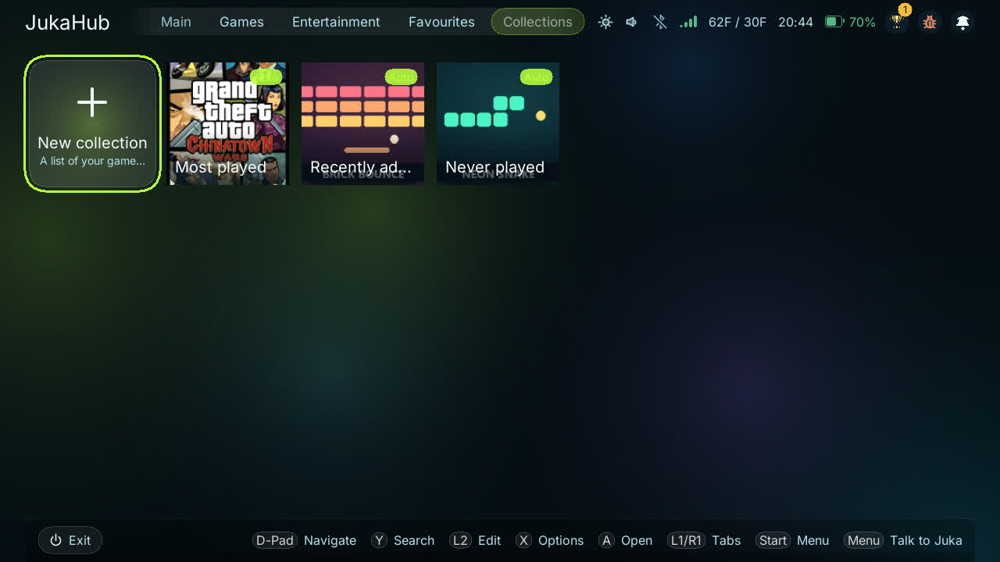
      <br>
      <b>Running on the handheld</b> — the Collections tab on a Smart Pro, with
      the device's temperature, Wi-Fi and battery in the top bar and the
      controller hints in the footer.
    </td>
    <td width="50%" valign="top">
      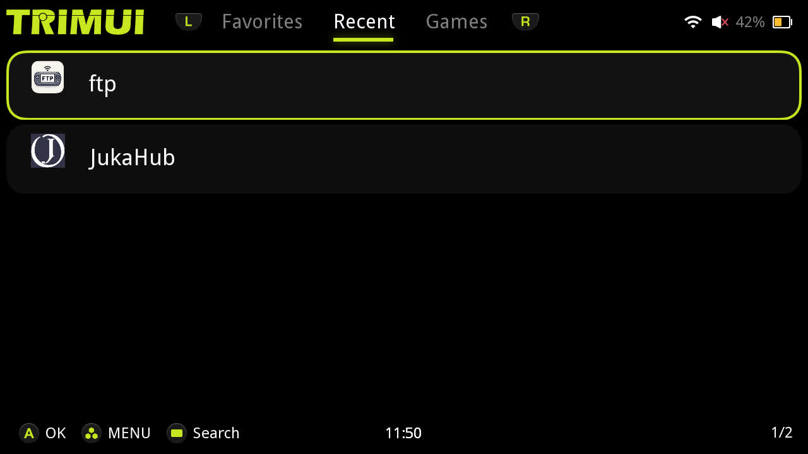
      <br>
      <b>And out again</b> — after <b>Select + Start</b> the stock TrimUI menu
      comes back, with JukaHub still one press away in its list.
    </td>
  </tr>
</table>

### What the card looks like

<p align="center">
  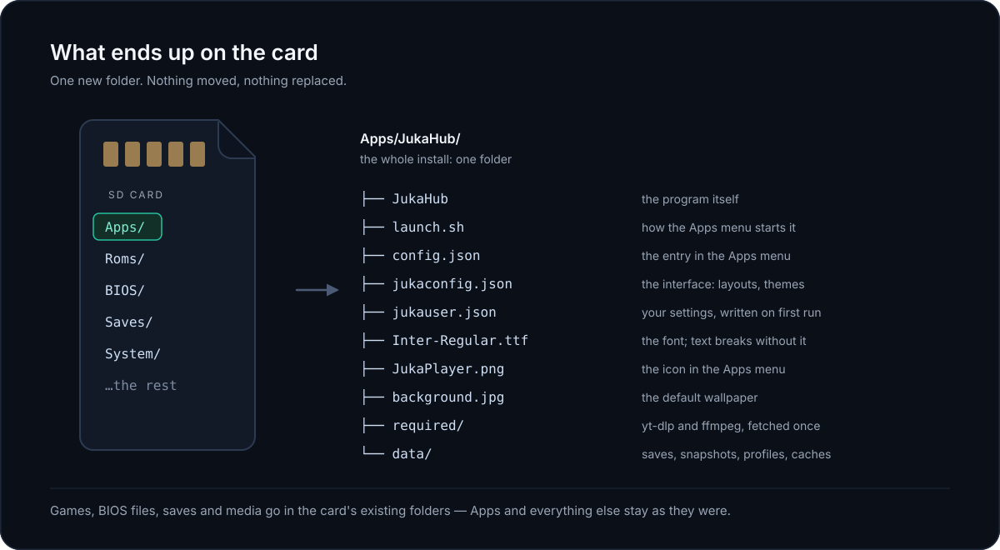
</p>

```text
SDCARD/Apps/JukaHub/
├── JukaHub            <- the application
├── launch.sh
├── config.json        <- the Apps-menu entry
├── jukaconfig.json    <- the interface
├── JukaPlayer.png     <- the icon in the Apps menu
├── Inter-Regular.ttf
├── background.jpg
├── jukauser.json      <- your settings (written on first run)
├── required/          <- yt-dlp and ffmpeg, fetched once
└── data/              <- saves, snapshots, caches
```

Games, BIOS files, saves and media are **not** part of the install: they stay
in the card's existing `Roms/`, `BIOS/`, `Saves/` and media folders, and
JukaHub reads them where they are.

### Which download?

| You want | File |
|---|---|
| JukaHub as an app in the Apps menu (the normal choice) | `JukaHub-Trimui.zip` |
| The handheld to power on **into** JukaHub, stock system untouched underneath | `JukaHub-OS-Trimui.zip` |
| To try JukaHub on a Windows PC | `JukaHub-Windows.zip` |

The same TrimUI download runs on the whole line — Smart Pro, Smart Pro S,
Brick, Brick Pro and Hammer. JukaHub detects the panel and picks its canvas:
1280×720 on the Smart Pro family, a compact 960×720 canvas scaled to the
1024×768 4:3 screens on the Bricks and the Hammer.

**JukaHub as the OS:** download `JukaHub-OS-Trimui.zip` instead and extract it
to the **root** of the card, merging the `Apps` and `System` folders. The
handheld then powers on straight into JukaHub OS; the stock system is never
replaced, holding **Select** through the logo gives the stock menu once, and
**Settings → JukaHub OS → Boot into JukaHub OS** off turns it back into an app.
Details: [docs/JUKAHUB_OS.md](docs/JUKAHUB_OS.md).

## First five minutes

1. **Join Wi-Fi.** Hold **Select** for Quick Settings → **Wi-Fi Networks**, or
   open **Start → Wi-Fi**. Search, weather and updates need it.
2. **Point your phone at the QR code** in Home's top-right corner (**Start →
   Tools → Phone companion** shows it in full). The phone becomes your
   keyboard, a remote, and a drop target for games, covers and music.
3. **Add games** by dropping them on the phone page, over FTP (below), or
   straight onto the card. **Games** → a console shows them with box art;
   **Continue** on Home resumes the last one you played.
4. **Watch something.** **Media → Tube** is YouTube, **Downloads** keeps videos
   for offline, and **Live TV**, **Podcasts** and **Library** are tabs on the
   same screen.
5. **Leave the way you like.** **B** goes back, **Start** opens the menu, and
   holding **Select + Start** saves, cleans up and returns to the stock
   launcher — from any screen.

## Controls

<p align="center">
  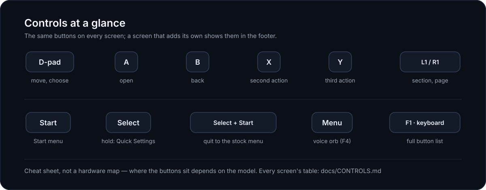
</p>

| Button | What it does |
|---|---|
| **D-pad** | Move and choose |
| **A / B** | Open / back |
| **X / Y** | The screen's second and third actions |
| **L1 / R1** | Previous and next section or page |
| **Start** | The Start menu: scenes, games, tools, device actions |
| **Select** (hold) | Quick Settings: Wi-Fi, Bluetooth, volume, brightness, LED lights, Close all apps |
| **Select + Start** | Quit to the stock launcher |
| **Menu** (F4) | The voice orb: say "open YouTube", "volume 50", or ask a question |
| **F1** (keyboard) | The full button list as an overlay |

Screens that add their own buttons show them in the footer. Here are two real
screens (not diagrams) with their own button rows:

<table>
  <tr>
    <td width="50%" valign="top">
      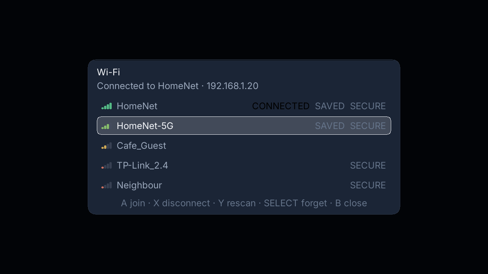
      <br>
      <b>Wi-Fi</b> — scan, join with the on-screen keyboard, and forget; the
      footer carries that panel's own buttons.
    </td>
    <td width="50%" valign="top">
      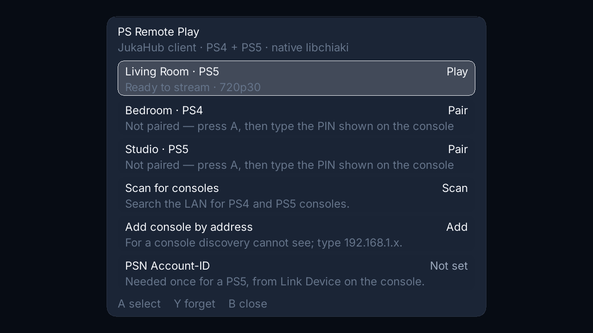
      <br>
      <b>PS Remote Play</b> — consoles it found, which are paired, and one
      press to stream; the footer is that panel's own.
    </td>
  </tr>
</table>

Per-screen tables (Live TV, video and music players, the on-screen keyboard,
terminal, JukaLand, desktop keys) are in **[docs/CONTROLS.md](docs/CONTROLS.md)**.

## What it can do

### Watch

- **YouTube** — search, trending, Shorts, saved favourites, history, downloads
  and a Continue row, all from the thumb-friendly **Media** screen.
- **Music** — open any audio file and the player takes its folder: shuffle,
  repeat, a play-next queue, favourites that survive restarts, 0.75×–2× speed,
  a sleep timer, synced `.lrc` lyrics and a full-screen spectrum. Playback
  continues while you browse; the feature map is in
  [docs/MUSIC_PLAYER.md](docs/MUSIC_PLAYER.md).
- **Offline music** — **Start → Tools → Downloads** saves a link as an m4a with
  progress, speed, pause/resume and per-row retry, then plays it with Wi-Fi off.
- **Podcasts, Live TV and IPTV** — a subscription library, IPTV playlists, and
  live channels that also work on a TV through Screen Share.
- **Books, PDFs and photos** — the EPUB/PDF reader, the image viewer (PNG, JPG,
  BMP, WebP, with folder browsing and zoom) and a text web browser.

### Play

- **Games Library** — `Roms/<system>/` console by console, with box art, play
  time, per-game launchers, a **Continue** row that resumes in one press, and a
  preview clip when you rest on a game. **X** opens **Netplay** (host, join a
  room on your Wi-Fi, or play online), so link-cable titles work without a
  cable. [docs/GAME_LIBRARY.md](docs/GAME_LIBRARY.md)
- **Emulators** — one-press downloads of libretro cores, per-game compatibility
  reports and honest hardware tiers, boost plans for N64/Dreamcast/PSP, and a
  daily update pass that keeps cores and runtimes current (with a one-press
  roll back). [docs/COMPATIBILITY.md](docs/COMPATIBILITY.md)
- **PS4/PS5 Remote Play** — JukaHub's own client, no Python, no separate Chiaki
  install. Scan the LAN, pair with the PIN, remember consoles and quality, and
  stream from the **PS4**/**PS5** tiles in Home's header.
  [docs/REMOTE_PLAY.md](docs/REMOTE_PLAY.md)
- **PortMaster ports, Windows apps, Android apps and homebrew** — PortMaster's
  catalogue, Wine through the firmware's own SDL2 (with Box64), the APK Store
  and AndroidRT for native Android games, itch.io homebrew, CHIP-8, WASM-4 and
  HTML5 demos. [docs/PORTMASTER.md](docs/PORTMASTER.md) ·
  [docs/WINDOWS_APPS.md](docs/WINDOWS_APPS.md) ·
  [docs/ANDROID.md](docs/ANDROID.md)
- **RomM server, NAS games and game profiles** — browse and download from your
  own RomM library, play from a network drive, and launch Windows games or
  scripts through profiles. [docs/ROMM_SERVER.md](docs/ROMM_SERVER.md) ·
  [docs/NETWORK_DRIVE.md](docs/NETWORK_DRIVE.md) ·
  [docs/GAME_PROFILES.md](docs/GAME_PROFILES.md)

### Keep

- **Save Manager** snapshots every emulator save folder into a versioned copy
  and restores one with a safety snapshot first. Snapshots are plain files, so
  they work without JukaHub. [docs/SAVE_MANAGER.md](docs/SAVE_MANAGER.md)
- **Save sync** — one QR code sets up Google Drive, WebDAV, RomM, Syncthing or
  a second handheld, and saves follow you around games by themselves.
  [docs/SYNC.md](docs/SYNC.md)
- **Card and battery health** — SD-card checks (including the fake-capacity
  test), battery health, and a **Continue** list built from what you actually
  used. [docs/CARD_CHECK.md](docs/CARD_CHECK.md)

### Connect

- **Phone companion** — the QR code on Home. Type on a real keyboard, use the
  D-pad as a remote, send links, drop files (they are sorted into the right
  folders for you) and send whole folders.
- **Screen Share** — the handheld's screen, games included, live in a browser
  on a TV or laptop, with sound and optional controller input.
- **Files over the network** — FTP for quick drops, SFTP/SSH for real file
  management, USB (MTP) over a cable, and WebDAV/SMB shares that appear as a
  drive. [docs/USB_FILE_TRANSFER.md](docs/USB_FILE_TRANSFER.md) ·
  [docs/NETWORK_SHARE.md](docs/NETWORK_SHARE.md)
- **Watch party, Chat and voice** — a LAN watch party, chat with files and
  clips, and a free voice room phones can join.
- **Smart home** — TP-Link Kasa/Tapo plugs and lights, Google Cast and Nest,
  Home Assistant (Apple Home and Google Home through Matter), plus Pi-hole,
  Tailscale and WireGuard status. [docs/SMART_HOME.md](docs/SMART_HOME.md)
- **Voice** — press **Menu** and say what you want, through the handheld's
  microphone or your phone. [docs/VOICE.md](docs/VOICE.md)

### Make it yours

- **47 themes**, animated GIF wallpapers, a **liquid background** that ripples
  where the focus lands, font scaling and high-contrast or colour-blind-safe
  palettes. [docs/THEMES.md](docs/THEMES.md) ·
  [docs/ACCESSIBILITY.md](docs/ACCESSIBILITY.md)
- **Smart Widgets** — battery saver (slower cadence, less motion, an OLED theme
  below 20%), light/dark themes that switch at times you pick, and start at
  login. [docs/AMBIENT.md](docs/AMBIENT.md)
- **The web builder** — the same layout file, edited visually in a browser, and
  pushed to the device over Wi-Fi.
- **Extend** — signed packages from a repository with rollback, plugins, and a
  Toolbox that installs `rclone`, `jq`, `ripgrep`, `fd`, `pandoc` and `age` on
  demand. [docs/PACKAGES.md](docs/PACKAGES.md) · [Toolbox](#toolbox)

<table>
  <tr>
    <td width="50%" valign="top">
      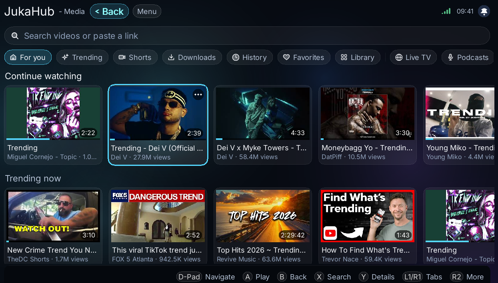
      <br>
      <b>Media</b> — YouTube with Continue watching and Trending; Shorts,
      Downloads, History, Favorites, Library, Live TV and Podcasts are tabs on
      the same screen.
    </td>
    <td width="50%" valign="top">
      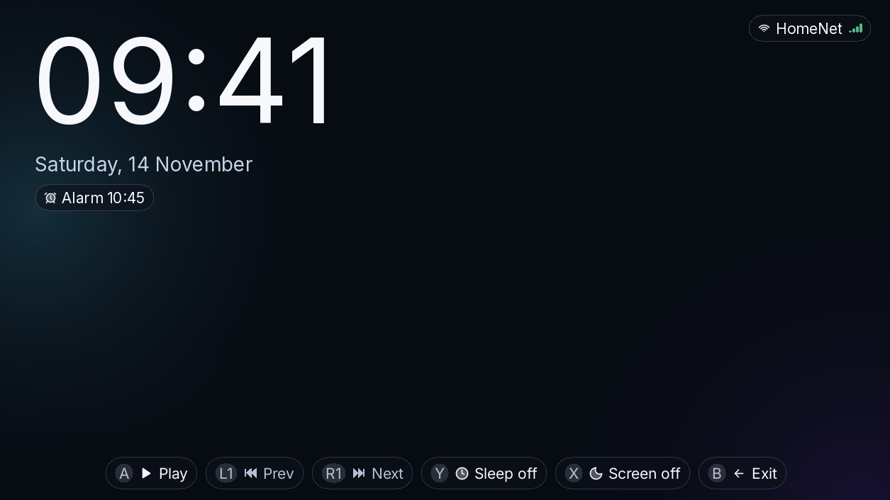
      <br>
      <b>Dock &amp; ambient</b> — the clock that takes over while charging or
      idle, with the next alarm, today's weather and new messages, and play,
      skip, a sleep timer and screen-off on the buttons.
    </td>
  </tr>
</table>

## Getting files in and out

**FTP, from Windows Explorer or Finder.** Open **Tools**, note the IP address,
and start the **FTP server** (**Tools → Network tools**). The panel shows the
address to type, such as `ftp://192.168.1.42:2121`, plus a one-time user name
and password. Drop files into `Roms`, `BIOS`, `Saves`, your media folders or
JukaHub's downloads; the rest of the card is not shared (on Windows the share
is a `shared` folder next to the app, so settings and saved logins are never
exposed). A wrong password costs a pause, three end the connection and ten from
one address lock it out. Both servers switch themselves off after 15 idle
minutes and when the handheld joins another network.

**SFTP/SSH, for editors, `scp` and backup scripts.** **Tools → SSH / SFTP**
starts a server that only speaks SFTP at `sftp://juka@192.168.1.42:2222` with a
one-time password, encrypted, with commands and tunnels refused. Connect with
WinSCP, FileZilla, Cyberduck, Finder or `sftp`. The whole file system is shared
only after **Share whole system…** is pressed twice. For unattended access, put
your public key in `Apps/JukaHub/data/ssh_authorized_keys`.

| Variable | Effect |
|----------|--------|
| `JUKAHUB_SSH_PORT` | Port to listen on (default `2222`), or set `ssh_port` in the config |
| `JUKAHUB_SSH_ROOT` | Folder to expose instead of the SD card |
| `JUKAHUB_SSH_FULL_ROOT=1` | Expose the whole file system on every start (Linux); or set `ssh_full_root` |
| `JUKAHUB_SSH_READONLY=1` | Refuse every upload, rename and delete; or set `ssh_readonly` |
| `JUKAHUB_COMPANION_PORT` | Port for the phone companion page (default `8317`) |

**The phone page** does the same from a phone: **Files** browses and uploads,
and **Send to the handheld** puts each dropped file where it belongs. Folders
keep their structure, and a file already there is replaced only after you
confirm.

| What you drop | Where it goes |
|---|---|
| A game (`.gba`, `.sfc`, `.nes` …) | its console's folder in `Roms` (the one this card's Games library reads) |
| A `.bin`, `.iso` or `.zip` | the same, once it has read the file's first bytes or the zip's list |
| A `.chd`, `.7z`, `.cue` or a file it cannot tell | it asks which console it is for |
| A picture named after a game (`Pokemon Red.png`) | that game's cover, beside it |
| Music and videos | the `Music` and `Videos` folders the media library reads |
| A BIOS file it knows (`scph5501.bin`, `gba_bios.bin` …) | `BIOS` |
| A folder of books, an album, a disc game | `Books/<Folder>`, `Music/<Folder>`, `Roms/<console>/<Folder>` |
| Anything else | `PhoneDrop` |

More on the first steps, the pairing card and sending whole folders:
[docs/GETTING_STARTED.md](docs/GETTING_STARTED.md).

## Share the screen on a TV (Screen Share)

The Smart Pro has no HDMI port, so JukaHub sends its screen to a browser
instead. **Start → Tools → Screen Share** (search finds it as *screen share*,
*cast*, *tv* or *hdmi*) shows a link and a QR code; open it on a smart TV,
laptop, tablet or phone on the same Wi-Fi — or on a laptop and cast that tab to
a TV — and the handheld's screen appears live, games included, with no app to
install.

- **A / Enter** starts or stops sharing. It is off by default.
- **Quality** (Left/Right): Smooth (640 px, 20 fps, the default), Balanced
  (960 px, 15 fps) or Sharp (full size, 10 fps).
- **Sound** is on by default: menus, music, videos and the games started while
  sharing is on, about a tenth of a second behind.
- **Controllers** ask first: **Play** on the viewer page requests control, and
  **A** on the handheld's panel allows it. A phone paired with the companion PIN
  plays without asking. One viewer plays at a time; **X** takes control back.
- **Games too** streams the framebuffer while a game runs (through ffmpeg at
  about 12 fps, or JukaHub's own reader at up to 8 fps and 640 px).
- On the viewer, **F** or a double-click toggles full screen and **M** cycles
  Fit / Fill / Pixel-perfect. Add `&tv=1` for a TV browser: no buttons, just the
  picture.
- A red **LIVE** pill shows on the handheld while anyone watches; it never
  appears in the stream.
- Up to six browsers can watch at once, and the link keeps working across
  restarts until **Y** makes a new one (the old one stops at once).

The link lets a viewer watch and listen; it cannot type or upload, and it
presses buttons only after you allow it on the handheld. The pairing QR is
painted over in the shared picture, but everything else on screen is shown —
including what you type — so share the link only with people you trust and
switch sharing off when you are done.

## Updating

JukaHub updates itself. On launch it checks the latest release and, when a
newer build exists, offers a **download icon in Home's header** (just left of
the weather). One press downloads the right archive, checks its SHA-256 against
the digest GitHub publishes, verifies the signed release manifest when there is
one, unpacks it, replaces the app files and restarts — with progress over
whatever screen is open. Settings, favourites and media are untouched, and an
interrupted update rolls back at the next launch. **What's new** opens once
after the restart; **Tools → Patch → Check for updates** runs the check by hand,
and `JUKAHUB_NO_AUTOUPDATE=1` turns the automatic check off.

## Privacy

Anonymous diagnostics are **off by default** (the switch is **Tools → Community
& support**). When enabled, about every ten launches the app files a public
GitHub issue marked `[Info]` with the build, device model, platform and coarse
diagnostics — no install ID, account, filename, log, config content or usage
history. **Report a bug** sends a redacted report straight from the device after
you review it, as a public issue, not under your name
([docs/BUG_REPORTS.md](docs/BUG_REPORTS.md)).

**To uninstall, delete the `Apps/JukaHub` folder.** Nothing else is left behind.

## Something is wrong?

Logs are on the SD card, so you can read them on a PC without SSH.

| Problem | What to do |
|---------|-----------|
| Not in the Apps menu | Reboot. Check the folder is `Apps/JukaHub` (or `Apps/JukaHub-Trimui`) and contains `launch.sh` and `JukaHub`. |
| Black screen, or it closes at once | Send `Apps/JukaHub/errors.txt` — the launcher's log — and the newest `crash-*.txt` next to it (on Windows, `%LOCALAPPDATA%\JukaHub\logs`). |
| A plugin, a setting or a bad update broke startup | Hold **L + R + Start** (Ctrl + Alt + R on a keyboard) while JukaHub starts: safe mode plus a recovery card (previous version, last good settings, reset settings). Three failed starts in a row do it by themselves. [docs/RECOVERY.md](docs/RECOVERY.md) |
| Screen blinks between the stock menu and JukaHub after an update | Both UIs are drawing: the launcher on the card is older than the app. Update once more, or copy `launch.sh` from the release archive over `Apps/JukaHub/launch.sh`, then reboot. |
| The stock menu glitches after leaving JukaHub | Send `Apps/JukaHub/errors.txt` and `Apps/JukaHub/autostart.log`, and say what the glitch looks like. |
| YouTube search fails | Check Wi-Fi; **Logs** in the Start menu has the app's own log. |
| A video goes black, then says it is downloading | The stream would not open, so JukaHub downloads it to the card and plays from there (**B** cancels). |
| Video stutters | Settings → playback resolution → try `480` or `360`. |
| Text shows as boxes | `Inter-Regular.ttf` is missing from `Apps/JukaHub`. |

`errors.txt` is the launcher log; **Logs → Export** writes the app's own log to
`Apps/JukaHub/logs.txt`. **Tools → Community & support → Report a bug** sends a
report with redacted diagnostics from the device and shows the issue number it
became. You can also ask on [Discord](https://discord.gg/R9qgJjh5jG).

## Build a screen in the web builder

The [web builder](https://generate.jukalang.com) lays out a handheld screen
without writing code: pick **Start blank**, **Start from template** or **Load
config**, drag Button, Label, Image, Input and Menu from the sidebar, edit the
selected element in the Inspector, then **Check** and **Export** as JSON or XML.
On a narrow screen it switches to Library, Canvas and Inspector tabs.

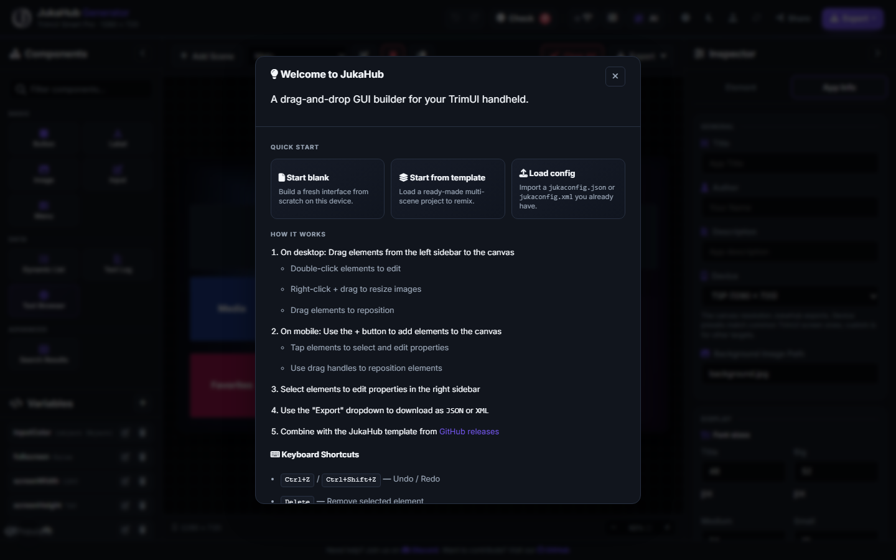

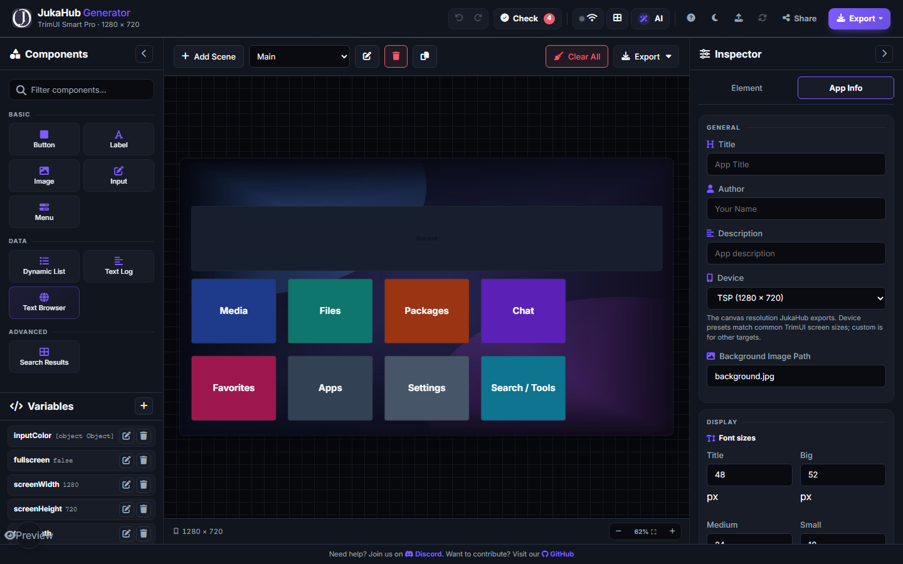

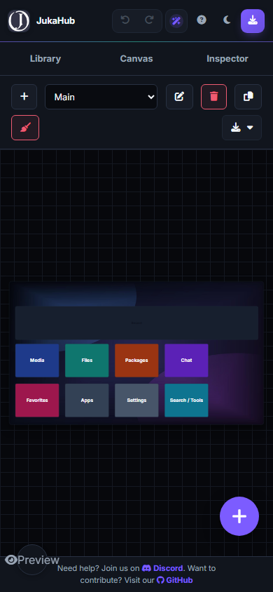

**Push a design to the handheld.** On the device, turn on **Settings → Network
→ Live Builder**; the row shows an address and a six-digit pairing code. In the
builder open **Device**, enter both and press **Push to device** — the design
reloads in place over Wi-Fi. The receiver switches itself off after 30 minutes
without use, and a design that can run programs or change protected settings
waits until you approve it on the device
([SECURITY.md](SECURITY.md#live-builder-the-web-builders-receiver)). Open the
builder from a copy on `http://localhost`: a browser does not let an HTTPS page
reach a plain HTTP device.

| Variable | Effect |
|----------|--------|
| `JUKAHUB_LIVE_BUILDER=0` / `1` | Never start the receiver / start it with JukaHub, whatever the Settings switch says |
| `JUKAHUB_LIVE_LAN=1` | On a PC, listen on the network instead of this computer only (or set `liveBuilderLAN`) |
| `JUKAHUB_LIVE_PORT` | Port to listen on (default `8422`; a busy port falls back to a free one, shown in Settings) |
| `JUKAHUB_LIVE_ORIGINS` | Extra builder origins allowed to call the device, comma-separated |

**Share a design.** **Share** turns the theme, fonts and layout into one link:
nothing is uploaded, the design is compressed into the URL, and account keys,
tokens and recent activity are stripped first. Opening the link offers
**Remix**, which loads a fresh copy into that person's workspace. For very large
projects, **Export → JSON** and send the file.

## Security

[SECURITY.md](SECURITY.md) has the threat model, the key management and the
limits; **Tools → Security & trust** shows the live state on the device.

- **Secrets are encrypted** — API keys and tokens in `jukaconfig.json` are
  AES-256-GCM with per-value nonces; `JUKAHUB_CRYPTO_KEY` sets your own key, and
  `./JukaHub -set-secret <field>` reads a value from stdin so it never lands in
  shell history.
- **Updates and packages are signed** — the Patch index is Ed25519-signed with
  the public key compiled into the binary, archives are SHA-256-checked, and a
  rollback copy is kept. HTTPS alone is never treated as authenticity.
- **Downloads come from a curated allowlist** — helpers and the
  [Toolbox](#toolbox) resolve only from repos listed in code, through a
  size-capped downloader, and run as a direct exec, never a shell.
- **The LAN servers are opt-in and visible** — FTP/SFTP start only when you
  press the row, SFTP makes its own password, and the posture view names
  whatever is listening.
- **No telemetry unless you ask** — off by default, limited to build and device
  facts when on.

## Toolbox

**Tools → Toolbox** installs popular command-line tools on demand and runs them
with visible output: `rclone`, `jq`, `ripgrep`, `fd`, `pandoc` and `age`. **A**
installs the first time and runs afterwards, **X** opens the keyboard for
arguments, **Y** copies the installed path. Installed tools also work from
Power tools → Script snippets, so one press can turn a tool into a button. The
three network scanners at the end of the catalogue (`naabu`, `httpx`, `dnsx`)
ask once before they touch another machine
([docs/TOOLBOX.md](docs/TOOLBOX.md#network-scanning)); installers come from each
project's own GitHub releases, and what is verified is in
[SECURITY.md](SECURITY.md#toolbox-and-helper-tool-downloads).

## Contributing

The one task list is the [engineering backlog](player/MODERNIZATION.md), with
priorities, the files to read and what "done" means. Small, well-scoped work is
the best way in: issues labelled
[`good first issue`](https://github.com/jukaLang/JukaHubV2/labels/good%20first%20issue).
A clone that builds is about five minutes
([docs/QUICK_START.md](docs/QUICK_START.md)); setup, checks and commit rules are
in [CONTRIBUTING.md](CONTRIBUTING.md). Questions go to
[Discord](https://discord.gg/R9qgJjh5jG) and
[Discussions](https://github.com/jukaLang/JukaHubV2/discussions); support paths
are in [SUPPORT.md](SUPPORT.md).

Images in this README come in three kinds. The app screenshots
(`screenshots/`) use stand-in data — the clock, date, alarm, network name and
pairing address are made up and the weather is left out — and
`JukaHub --screenshot-tour ../screenshots`, run from `player/`, retakes them
the same way ([Screenshots](docs/DEVELOPMENT.md#screenshots)). The two images
in **On the device** are captures taken from a real Smart Pro's screen
(`hardware-captures/`). The install steps, the SD-card layout and the controls
sheet are drawn diagrams, not captures of a device.

## Documentation

**Start here:**

| Page | Covers |
|------|--------|
| [The ten-minute tour](docs/TOUR.md) | what the app feels like, from a cold SD card to Continue, in one story |
| [Getting started](docs/GETTING_STARTED.md) | a player's first steps in JukaHub |
| [Controls](docs/CONTROLS.md) | every button and key, screen by screen |
| [Developer quick start](docs/QUICK_START.md) | the five-minute path to a clone that builds, runs and checks |
| [Configuration](docs/CONFIGURATION.md) | `jukaconfig.json`, variables, elements, all triggers |
| [Building](docs/BUILDING.md) | Windows/Linux/ARM64 builds, SD-card packaging, releases, CI |

<details>
<summary><b>Every other page</b> — games, media, network, device and developer reference</summary>

**Games and emulation**

| Page | Covers |
|------|--------|
| [Games Library](docs/GAME_LIBRARY.md) | console-by-console ROM browser, box art, launcher resolution, Continue list |
| [ROM Audit](docs/ROM_AUDIT.md) | No-Intro/Redump DAT check: missing games, bad dumps, duplicates, renames |
| [Emulator compatibility](docs/COMPATIBILITY.md) | per-game reports, hardware tiers, core builds and updates |
| [Box art](docs/BOX_ART.md) | libretro thumbnails, LaunchBox, ScreenScraper, `.7z` games by checksum |
| [Looks](docs/LOOKS.md) | per-console picture looks (CRT, LCD, pixel transparency), overlays, overscan |
| [Widescreen](docs/WIDESCREEN.md) | 16:9 hacks per console and per game, PlayStation analog |
| [RetroAchievements](docs/RETROACHIEVEMENTS.md) | achievement options per launch, sign-in, unlock lights |
| [Game hotkeys](docs/GAME_HOTKEYS.md) | RetroArch's hotkey button and shortcuts per console and per game |
| [Light gun](docs/LIGHT_GUN.md) | gun games with the right stick as the gun, per-game tuning |
| [CHIP-8](docs/CHIP8.md) · [WASM-4](docs/WASM4.md) | the built-in retro consoles and their cart shelves |
| [PortMaster](docs/PORTMASTER.md) | browsing and installing ports with their runtimes |
| [Get Homebrew](docs/HOMEBREW.md) | games from itch.io for ten consoles, installs and updates |
| [Game profiles](docs/GAME_PROFILES.md) | Windows games and scripts through Box64/Wine |
| [Windows Apps](docs/WINDOWS_APPS.md) | Wine, Box64, WestonPack and the no-X11 display bridge |
| [Android and the APK Store](docs/ANDROID.md) | APK verdicts, AndroidRT for native apps and games, Waydroid, what cannot run |
| [Minecraft on AndroidRT](docs/ANDROID-MINECRAFT.md) | the one Android game tested end to end on a Smart Pro |
| [J2ME](docs/J2ME.md) · [Java](docs/JAVA.md) · [Godot](docs/GODOT.md) | other app runtimes and what they need |
| [Netplay and LAN play](docs/REMOTE_PLAY.md) | Remote Play, the watch party and rooms on your Wi-Fi |
| [Cloud gaming](docs/CLOUD_GAMING.md) · [PC streaming](docs/PC_STREAMING.md) | Game Pass and GeForce NOW, Moonlight and Vibepollo |
| [Controller Mode](docs/CONTROLLER_MODE.md) | the handheld as a controller: USB, Wi-Fi to JukaPad, DSU |
| [Party Mode](docs/PARTY_MODE.md) | Guess the Game, discovery and the party page |
| [Game curation screens](docs/CURATION.md) | essentials checklist, theme profiles, compatibility votes |
| [Save Manager](docs/SAVE_MANAGER.md) | snapshots, restore, Syncthing setup, phone resume bundle |
| [Session safety](docs/SESSION_SAFETY.md) · [Pick up and play](docs/PICK_UP_AND_PLAY.md) | saves that survive a crash, and what was seen to work on your model |
| [Ghost Challenges](docs/GHOST_CHALLENGES.md) | racing a friend's run of the arcade games |
| [Memory scanner](docs/MEMORY.md) | RAM search for a running game and its limits |
| [Recordings](docs/RECORDINGS.md) · [Time-lapse](docs/TIMELAPSE.md) | captures the emulator writes, and playthrough time-lapses |
| [Game Boy Printer](docs/GB_PRINTER.md) | printing from Game Boy games, the scrapbook |
| [Game translation](docs/GAME_TRANSLATION.md) | translating the game screen through RetroArch's AI service |

**Media and everyday use**

| Page | Covers |
|------|--------|
| [Video and music](docs/MUSIC_PLAYER.md) | the audio player's features and roadmap |
| [Game soundtracks](docs/SOUNDTRACKS.md) | NSF, SPC, GBS, VGM, SID and module music with covers and fades |
| [Spatial audio](docs/SPATIAL_AUDIO.md) | virtual surround on headphones, wider speakers, games too |
| [Ambient and dock](docs/AMBIENT.md) | the charging/idle clock, weather, now-playing, sleep timer |
| [Home tabs](docs/HOME_TABS.md) | how Home is organised and how to rearrange it |
| [Browser](docs/BROWSER.md) | the text web browser, bookmarks, downloads |
| [Everyday apps](docs/EVERYDAY_APPS.md) | Tasks, Voice Memos, Paint, Stopwatch, Solitaire |
| [Text and hex editor](docs/TEXT_EDITOR.md) · [Pads](docs/PADS.md) | editing files, and the sample sequencer |
| [Tools](docs/TOOLS.md) | search, pins and quick checks |
| [Open with and default apps](docs/OPEN_WITH.md) | which app opens what |
| [App Center](docs/APP_CENTER.md) · [Linux packages](docs/LINUX_PACKAGES.md) | TrimUI apps and distribution packages |
| [Email and calendar](docs/EMAIL_CALENDAR.md) | accounts added from your phone, reminders, encryption |
| [Theme files](docs/THEMES.md) · [Look packs](docs/LOOK_PACKS.md) | the theme schema and icon/sound packs |
| [Quick menu](docs/QUICK_MENU.md) | the TrimUI quick menu, its tiles and picture |
| [Accessibility](docs/ACCESSIBILITY.md) | text scaling, palettes, controller remap |
| [Kid mode](docs/KID_MODE.md) | Kiosk and Kid modes, the parent code, the escape hatch |
| [Voice command](docs/VOICE.md) · [Chat voice](docs/VOICE_CHANNEL.md) | the voice orb, voice rooms, clips |
| [Local AI](docs/LOCAL_AI.md) · [AI tools](docs/AI_TOOLS.md) | the offline models and the AI helpers |
| [Profiles and Guest](docs/PROFILES.md) | separate settings and saves per person |

**Network, files and device**

| Page | Covers |
|------|--------|
| [Wi-Fi](docs/WIFI.md) | the network picker: scanning, joining, saved networks |
| [USB file transfer](docs/USB_FILE_TRANSFER.md) | the card on a computer over MTP |
| [USB controller](docs/USB_GAMEPAD.md) · [USB OTG](docs/USB_OTG.md) | the USB-C port as a controller, and host mode |
| [WebDAV share](docs/NETWORK_SHARE.md) · [SMB share](docs/SMB_SHARE.md) | the card as a drive in Explorer, Finder and Linux |
| [NAS and network drives](docs/NETWORK_DRIVE.md) | games from a server, SMB, SFTP, WebDAV |
| [VNC and Telnet](docs/VNC.md) | watching and controlling the handheld from a PC |
| [Tailscale](docs/TAILSCALE.md) · [VPN](docs/VPN.md) · [DNS](docs/DNS.md) | reaching the device from anywhere, WireGuard, DNS choices |
| [Hotspot](docs/HOTSPOT.md) | sharing the handheld's connection |
| [Smart home](docs/SMART_HOME.md) | Kasa/Tapo, Cast, Home Assistant, Matter, MQTT |
| [Sync](docs/SYNC.md) · [Device Sync](docs/DEVICE_SYNC.md) | saves everywhere, and two handhelds sharing |
| [RomM server](docs/ROMM_SERVER.md) | your own game library over the network |
| [SD card move](docs/SD_CARD_MOVE.md) · [Card check](docs/CARD_CHECK.md) | moving to a new card, checking card health |
| [Recovery](docs/RECOVERY.md) | safe mode, the recovery chord, low-battery suspend |
| [Battery warnings](docs/BATTERY_WARNINGS.md) · [Idle](docs/IDLE.md) | low-battery behaviour and idle actions |
| [TV mode](docs/TV_MODE.md) | the Brick Pro on a TV |
| [Device tuning](docs/DEVICE_TUNING.md) · [Controller test](docs/CONTROLLER_TEST.md) | per-launch tuning, stick calibration, drift checks |
| [Device drivers](docs/DEVICES.md) | the four handhelds, their model codes and what is detected |
| [Hardware validation](docs/HARDWARE_VALIDATION.md) | what was observed on real hardware |
| [Boot](docs/BOOT.md) · [JukaHub OS](docs/JUKAHUB_OS.md) | boot logo, silent boot, and running as the shell |
| [Packages](docs/PACKAGES.md) · [Plugins](docs/PLUGINS.md) | the package format, the Patch manager, plugins |
| [Bug reports](docs/BUG_REPORTS.md) | what the device sends, and what it never does |
| [Terminal](docs/TERMINAL.md) | the built-in shell |
| [Everyday tools, network scanning](docs/TOOLBOX.md) | installing and running command-line tools |

**Build it**

| Page | Covers |
|------|--------|
| [Architecture](docs/ARCHITECTURE.md) | the three runtimes and where a change lands |
| [Developer guide](docs/DEVELOPMENT.md) | architecture, design system, key files |
| [Code style](docs/STYLE.md) | naming, comments, config keys, the device budget |
| [External dependencies](docs/DEPENDENCIES.md) | what it links against and why |
| [TrimUI packaging](player/trimui/README.md) | device package, install and troubleshooting notes |
| [Updater design](docs/UPDATER_TUF.md) · [Checkpoints design](docs/CHECKPOINTS.md) | the updater, and a milestone not yet implemented |
| [Video hardware decode](docs/VIDEO_VPU_OFFLOAD.md) · [Private glibc](docs/PRIVATE_GLIBC.md) | device-specific runtime work |
| [UX review](docs/UX_REVIEW.md) | the November 2026 design critique |
| [Engineering backlog](player/MODERNIZATION.md) | every open task with priority, files and acceptance criteria |
| [Release checklist](docs/RELEASE_CHECKLIST.md) | what a release run needs |
| [Decisions (ADRs)](docs/adr/) | the decisions other code has to live with |
| [Security](SECURITY.md) | threat model, secret storage, signed updates, the posture view |

</details>

## Contributors

- **NiNjaMAN1210** — for his extensive work in testing and helping develop new
  features.

## License and thanks

AGPL-3.0 — see [LICENSE](LICENSE).

Thanks to Nevrdid for finding and documenting bugs, Arthur Gregorio for Go
guidance, StarDrive and DigestPrism for supporting the app, @Dio for
contributions to improving key security, and everyone in the Juka Discord for
making it possible.
