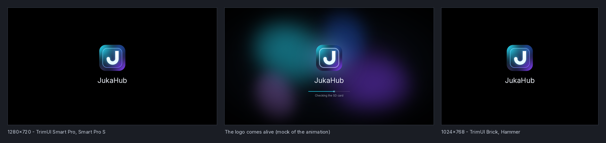

# Boot: the logo, the animation and starting with the device

When a TrimUI starts straight into JukaHub, it should feel like the handheld
runs JukaHub, not like an app opening on top of another launcher. Three pieces
do that: the **boot logo** the firmware shows while Linux starts, the **boot
animation** that brings that logo to life, and **Home building itself** at the
end. Opening JukaHub from the stock launcher, or from a shortcut on a PC, keeps
a short version of the same thing, because a fast start is worth more than a
long greeting. (A PC that starts JukaHub at login gets the full boot too: the
login launcher asks for it.)

## What a power-on looks like

1. **The firmware's boot logo.** A black screen with the JukaHub tile over its
   name, from the moment the device powers on until Linux is up. This is a
   picture stored on the device itself, so it appears once it has been
   installed with **Settings → General → Boot logo** (below); until then the
   firmware shows its own logo.
2. **The logo comes alive.** JukaHub's first frame puts the tile and the name
   on exactly the pixels the firmware's picture had them, so the still logo
   seems to wake up rather than be replaced (that is when the boot hook
   started JukaHub and the installed boot logo is JukaHub's; otherwise the
   logo fades in from black). JukaHub's own startup work runs first, while
   that still frame holds, so nothing stutters once it moves. Then a light
   runs once around the glass pane's rim, the backdrop's four lights come up
   one after another with the four bells of the startup chime, the name
   catches a glint, and a thin progress line shows the startup checks still
   running, with the current one named under it.
3. **Home builds itself.** The tile fades through, the name glides up into its
   place in the header, the cards rise into place in reading order and the rest
   of the screen fades in. Then Home is live.

After the startup work, the beats take under three seconds and Home's arrival
about one more. Any button skips straight to step 3, at the quick pace. The
handheld comes with **Reduce motion** on for its menus, but the boot moves all
the same; it follows **Reduce motion** once you switch it yourself (Settings →
Display & theme, or Quick Settings). Switched on by hand, and always in battery
saver, the beats are the same but every change is a fade: nothing travels,
scales or slides.

On stock and CrossMix firmware JukaHub is started by its boot hook through the
firmware's own launcher queue (see **Start JukaHub at login** in
[CONFIGURATION.md](CONFIGURATION.md)). Depending on how that firmware's
launcher loop reads its queue, the stock launcher can still show for a moment
between the boot logo and JukaHub. When it does, the hook leaves `menu` in
`/tmp/jukahub-autostart.lock` as it closes the menu, the queued command puts
black on `/dev/fb0` before `launch.sh` runs (instead of leaving the menu's last
picture frozen on the screen), and the boot fades in from that black rather
than starting from the logo's still frame, which is no longer on screen
(`bootos.go`, through `trimuiAutostartMenuShown`). A launcher loop that reopens
the menu instead of running the queue is not shown the menu again. Loops the
hook has to pause for a direct start are recorded by process id in
`/tmp/jukahub-paused`, which `launch.sh` resumes when JukaHub hands the screen
back.

## Opening JukaHub as an app

From the stock launcher's Apps list, or from a shortcut on a PC, the same logo
and name come up over black and Home builds itself, compressed into the time
the app needs to start anyway: the logo part stays inside the existing
two-second startup budget and gets out of the way as soon as the startup work
is done, and Home's cards arrive in under half a second, starting before the
budget runs out. A press during it brings Home up at once. Two cases skip the
animation entirely, as before: a relaunch within ten minutes of the last one
(after an update or a setting that restarts the app), and a card so slow that
the budget is already spent.

## Settings

Three rows in **Settings → General**, after **Start JukaHub at login**:

| Row | What it does |
| --- | --- |
| Startup animation | **Full at power-on** (default): the full boot when the device starts into JukaHub, the short one when you open it. **Full every time**: the full boot on every start. **Always quick**: never the full one. Saved as `startupAnimation` = `power`, `always` or `quick`. |
| Boot logo | TrimUI only. Says what the device shows at power-on: **JukaHub**, **Original** (the picture that was there before JukaHub's), **Custom** (another tool changed it), **Restore needed** (a write was cut short, by a power loss say) or **Unavailable** (the second line says why); **Checking…** while it looks and **Writing…** while it writes. Press **A** twice to install the JukaHub logo — the first press arms it and says what will happen, the second within four seconds does it. When the JukaHub logo is installed (or a restore is needed), the same two presses put the previous picture back. |
| Watch the boot animation | Plays the power-on sequence now, over the screen you are on, and comes back to it. The progress line is simulated, since nothing is starting. |

## Starting the full boot from a script

A launcher of your own can ask for the full boot:

| Trigger | Use |
| --- | --- |
| `JUKAHUB_BOOT=1` | export it before starting JukaHub |
| `--boot` | pass it on the command line |

Either one makes the start a power-on whatever **Startup animation** says,
except **Always quick**, which is the user's answer to that question — and
except when JukaHub has already started since the machine booted: a restart
(after an update, a reset, a crash) inherits the trigger, and replaying the
whole boot then would be a stutter (Recovery's restart drops the trigger
anyway). Each first frame is recorded with the kernel's boot id, so "since
the boot" holds even when the network set the clock in between; on a PC
without one it means "in the last two minutes".

### How JukaHub knows it is a power-on

Without either trigger, JukaHub decides by itself, in this order:

- the marker that the **Start JukaHub at login** boot hook leaves for the start
  it launched (`Apps/JukaHub/.autostart-pending`);
- on a TrimUI, the device has been up for less than two and a half minutes
  (the hook may wait up to two for the stock launcher), **Start JukaHub at
  login** is on, and the hook's queued command has started JukaHub during this
  boot (it leaves `/tmp/jukahub-autostart.ran`) — so a start from the menu
  after the hook stood aside is an ordinary start.

Neither counts once JukaHub has drawn a first frame since this boot, so coming
back to JukaHub, or a restart after an update, never plays the power-on
sequence again. **Full every time** is the exception: it means every start.

The startup benchmark (`JUKAHUB_STARTUP_BENCH=1`) never counts as a power-on
unless `JUKAHUB_BOOT=1` is set too, so it keeps measuring the ordinary start.

## The boot logo installer

### What it writes

The picture is the one above: black, the tile, the name. It is rendered on the
device at the size and in the pixel format of the firmware's own file, so the
firmware is handed exactly the kind of file it already reads.

### How it finds the picture

Only by name, never by position. It looks the partition up in `/dev/by-name/`,
in the `partitions=` list on the kernel command line (`/proc/cmdline`) and in
the partition names the kernel reports in `/sys/class/block`; every one of them
that knows the name must point at the same device. The partition must also sit
on the handheld's internal eMMC (the kernel reports it as `MMC`, where a card
says `SD`) and not on the disk JukaHub itself runs from. It knows the two places
Allwinner devices keep their boot logo:

- a FAT partition named `boot-resource` (or `bootloader`) holding
  `bootlogo.bmp`. It is mounted read-only to look, and read-write only for the
  moment of the write; a mount that already exists is reused once it is checked
  to really hold that partition, and put back to read-only afterwards.
- a raw partition named `bootlogo` whose contents start with a BMP.

If neither is there, the row says **Unavailable** and nothing is written.

### What it refuses

It stops, without writing, when:

- the device is not a TrimUI, or the partition is not found by name;
- the sources that name partitions disagree, or two stores hold a logo — even
  if JukaHub would refuse one of them (which one the bootloader shows is not
  something to guess);
- the partition holds the running system, is not on the internal eMMC, or is on
  the disk JukaHub runs from;
- its own record (`state.json`, below) exists but cannot be read, or was written
  by another version;
- the FAT partition has no `bootlogo.bmp`;
- the file is not an uncompressed BMP of 24 or 32 bits per pixel (plain RGB, or
  32-bit bit fields on whole bytes), is taller than it is wide, is smaller than
  320x240 or larger than 4096x4096, or is over 8 MiB;
- a raw partition's BMP claims to be longer than the partition.

### How it writes

Everything that decides the write — reading the firmware's file, drawing the
picture, the backup and its record below — happens while the partition is
mounted read-only. It is opened for writing only for the write itself, and only
if the file still is the one that was backed up (otherwise nothing is written
and the row asks to try again). The firmware file's own header is kept as it is;
only the pixels are replaced, so the new file is exactly as long as the old one
and goes in place — no new file, no truncation, nothing else on the partition
touched (FAT itself only notes the file's new modification time). Then it
flushes the write to the device's storage, asks the kernel to forget its cached
copy, reads the file back and compares SHA-256 checksums, and checks once more
through a fresh mount after it has let go of the partition. A write that does
not read back puts the previous picture straight back. The row only says
**JukaHub** once the read-back matches. If a partition the system had mounted
read-only cannot be made read-only again afterwards, the logo stays installed
and the message says so.

### Backups and Restore

Before its first write it copies the picture that was there to
`Apps/JukaHub/data/bootlogo/before-<hash>.bmp` on the SD card, next to a small
`state.json` recording where it came from. **Boot logo** with the JukaHub logo
installed writes that copy back, only to the partition it came from and only on
the same model of handheld; it refuses if the file on the device has since
changed size or header (another tool replaced it — restore it with that tool
instead). A copy is never overwritten, and `state.json` keeps the path of the
very first one ever made on the card. When the row finds that another tool has
replaced the JukaHub logo, the record stops calling it installed.

On CrossMix, the JukaHub picture is also copied to
`Apps/BootLogo/Images/JukaHub.bmp`, so CrossMix's own BootLogo app can pick it
like any other logo.

## Flashing by hand

The reference pictures are in the repository under
[`branding/bootlogo/`](../branding/bootlogo/), rendered by
[`branding/mkbootlogo.py`](../branding/mkbootlogo.py) from the same placement
the app uses:

| File | Devices |
| --- | --- |
| `jukahub-bootlogo-1280x720.bmp` | TrimUI Smart Pro, Smart Pro S |
| `jukahub-bootlogo-1024x768.bmp` | TrimUI Brick, Hammer |

Both are 24-bit uncompressed BMPs (about 2.8 and 2.4 MB).

- **CrossMix:** copy the file into `Apps/BootLogo/Images/` and run the BootLogo
  app. It checks that the file really is a BMP, at most 1280x720 and under
  6 MB, and 24-bit is the depth it recommends. CrossMix's own notes say the
  tool is not compatible with firmware newer than 1.0.4 hotfix 6.
- **NextUI:** put the file in `Tools/tg5040/Bootlogo.pak/smartpro/` (Smart Pro),
  `Tools/tg5040/Bootlogo.pak/brick/` (Brick, Hammer) or
  `Tools/tg5050/Bootlogo.pak/smartpro_s/` (Smart Pro S), then run
  **Tools → Bootlogo**.

## If something goes wrong

- **Boot logo → A twice** puts the previous picture back.
- The backup in `Apps/JukaHub/data/bootlogo/` is an ordinary BMP: any of the
  tools above can flash it.
- A full firmware reflash from TrimUI's own update file rewrites the device's
  partitions, the stock boot logo with them.
- The boot logo is only a picture the bootloader shows before it starts
  Linux. Damaged logos written by other tools (half an image) have been
  reported to boot normally, and JukaHub's write is the smallest one possible
  for exactly that reason.

## Not verified on hardware yet

This was written without a TrimUI on the desk, and it says so:

- How TrimUI's own firmware stores its boot logo has not been confirmed. The
  installer is built on Allwinner's usual layout and probes before it trusts
  it; on anything it does not recognise it says **Unavailable** and writes
  nothing.
- TrimUI's firmware 1.1.0 "increased the boot partition space to 22MB for the
  boot logo", so 1.0.x and 1.1.x devices may not store it the same way.
- CrossMix's BootLogo tool says it is not compatible after firmware 1.0.4
  hotfix 6, which points the same way.
- The black hand-over at boot: whether writing black to `/dev/fb0` blanks the
  PowerVR panel cleanly, and whether CrossMix's launcher loop runs the queue
  once the menu is closed (`autostart.log` says which path started JukaHub).

If **Boot logo** says **Unavailable** on your device, its second line says what
was missing; **Tools → Logs** has the details for a report.

## For contributors

| File | What it does |
| --- | --- |
| `player/bootlogo_layout.go` | where the tile, the name and the progress line sit, in fractions of the screen height — shared by the firmware picture, the animation's first frame and `mkbootlogo.py` |
| `player/bootos.go` | the boot sequence: power-on or app launch, the timeline, the chime's timing |
| `player/bootarrive.go` | Home building itself out of the first screen's warm render |
| `player/splash.go` | the startup entry point that hands over to the boot sequence |
| `player/autostart.go` | the boot hook (in its template): the queue, closing the menu, the black hand-over, `trimuiAutostartMenuShown` |
| `player/bootlogo.go`, `bootlogo_linux.go`, `bootlogo_other.go` | the installer: finding the partition, the BMP rewrite, backups, Restore, the Settings row |
| `branding/mkbootlogo.py` | the reference pictures above |

Change a placement constant in `bootlogo_layout.go` and its twin in
`mkbootlogo.py` together, with the numbers the script asserts (the sprite, the
word and the track): the script refuses to run when its own copy drifts from
those numbers, but nothing compares it with the Go side, so a change to
`bootlogo_layout.go` alone would let the firmware's logo and the boot
animation's first frame drift apart unnoticed. Rerun it with
`python3 branding/mkbootlogo.py`; files that did not change are left alone.
