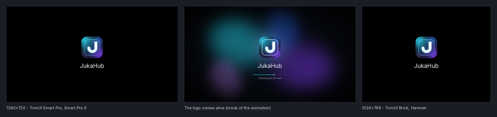

# Boot: the logo, the animation and starting with the device

When a TrimUI starts straight into JukaHub, it should feel like the handheld
runs JukaHub, not like an app opening on top of another launcher. Three pieces
do that: the **boot logo** the firmware shows while Linux starts, an optional
**boot animation** that brings that logo to life, and **Home building itself**
at the end.

**Since 2026-11-18 the default is the fastest start:** no boot animation
(**Boot animation → None**) on every device, the PC included, and on stock
firmware the boot hook starts JukaHub in place of the stock menu (**Skip the
stock menu at boot**, below). Home appears as soon as it is ready, straight
after the firmware's logo; the startup chime, when **Startup & shutdown sound**
is on, starts with Home's first frame instead of with an animation, and the
spoken greeting follows it, so neither holds the screen up. Pick a style under
**Boot animation** to get the animation back: everything below then applies
as before. (A PC that starts JukaHub at login then gets the full boot too: the
login launcher asks for it.)

## What a power-on looks like

With the default (**None**) a power-on is step 1, then Home. With a style
picked:

1. **The firmware's boot logo.** A black screen with the JukaHub tile and name,
   from the moment the device powers on until Linux is up. On the stock Smart
   Pro 1.1.0 the firmware uses a short horizontal banner; other images may use
   a full-screen picture. This is a
   picture stored on the device itself, so it appears once it has been
   installed with **Settings → General → Boot logo** (below); until then the
   firmware shows its own logo.
2. **The logo comes alive.** For a full-screen firmware logo JukaHub's first
   frame puts the tile and name on the same pixels, so the still logo
   seems to wake up rather than be replaced (that is when the boot hook
   started JukaHub and the installed boot logo is JukaHub's; otherwise the
   logo fades in from black). JukaHub's own startup work runs first, while
   that still frame holds, so nothing stutters once it moves. Then the logo
   makes its entrance in the style chosen under **Boot animation** (below;
   Cinematic falls from the screen onto cracking ground), and the rest follows as in
   the **Classic** style: a light
   runs once around the glass pane's rim, the backdrop's four lights come up
   one after another with the four bells of the startup chime, the name
   catches a glint, and a thin progress line shows the startup checks still
   running, with the current one named under it. With a name set in
   **Settings → Your name**, "Welcome back, *name*" fades in under the
   JukaHub name as it comes into focus (the app-launch hello shows it too).
3. **Home builds itself.** The tile fades through, the name glides up into its
   place in the header, the cards rise into place in reading order and the rest
   of the screen fades in. Then Home is live.

After the startup work, the beats take under three seconds and Home's arrival
about one more. Any button skips straight to step 3, at the quick pace. The
handheld comes with **Reduce motion** on for its menus, but the boot moves all
the same; it follows **Reduce motion** once you switch it yourself (Settings →
Theme & look, or Quick Settings). Switched on by hand, and always in battery
saver, the beats are the same but every change is a fade: nothing travels,
scales or slides.

On stock and CrossMix firmware JukaHub is started by its boot hook through the
firmware's own launcher queue (see **Start JukaHub at login** in
[CONFIGURATION.md](CONFIGURATION.md)). By default the hook also puts a tiny
stand-in over `/usr/trimui/bin/MainUI` for that one boot (a RAM bind mount; no
file of the firmware is written), so the launcher loop runs the queue in place
of the stock menu: the menu never opens, and the seconds it took to start and
settle before the hook could close it are gone. Every later run of MainUI is
the real menu, the stand-in comes off once JukaHub started (or after 20 s if
the loop never ran it), and a start that hung still makes the next boot stay on
the stock menu. **Settings → General → Skip the stock menu at boot** off (the
app folder then holds `.autostart-keep-menu`) goes back to the older way, and
so does a firmware without `mount` or MainUI. Then, depending on how that
firmware's launcher loop reads its queue, the stock launcher can show for a
moment between the boot logo and JukaHub. When it does, the hook leaves `menu` in
`/tmp/jukahub-autostart.lock` as it closes the menu, the queued command puts
black on `/dev/fb0` before `launch.sh` runs (instead of leaving the menu's last
picture frozen on the screen), and the boot fades in from that black rather
than starting from the logo's still frame, which is no longer on screen
(`bootos.go`, through `trimuiAutostartMenuShown`). A launcher loop that reopens
the menu instead of running the queue is not shown the menu again. Loops the
hook has to pause for a direct start are recorded by process id in
`/tmp/jukahub-paused`, which `launch.sh` resumes when JukaHub hands the screen
back.

## Boot animation styles

**Settings → General → Boot animation** chooses what the logo does (saved as
`bootStyle`; `bootstyles.go`). Left and Right step through the styles below;
**A** lists them with a check on each one picked, and **A** on a style adds it
or takes it out, so you can pick several (2026-11-24): each start then plays
one of them, never the one the last start played. **Watch the boot animation**
plays the chosen one (or the next of the ones picked), vibration included.

| Style | `bootStyle` | What you see |
| --- | --- | --- |
| **Cinematic** | `cinematic` | The camera looks straight down at the ground, lit in a pool round the logo's place, and the logo falls to it from the screen: it appears big, over four times its size and spilling past the screen's edges, as if just under the glass, and shrinks to its resting size as it falls, faster and faster, trailing a short blur, its shadow sliding in under it. On the frame it lands, one hard buzz of the vibration motor, the picture shakes for under half a second, a short flash, a wave of light runs out along the ground, dust and sparks burst out all round and the ground breaks like stone (`bootcracks.go`, 2026-11-24): cracks run out from under the tile in every direction, first from its corners, widest at the tile, jagged, forking and tapering to hairlines, each a dark groove lit from the top-left with a thin bright far lip; rings of cracks split the slab round the tile into pieces, some tipped a little so they catch more or less light; the edge it hit is crushed, with hair cracks all round, and a little grit lies scattered — a different pattern every boot. The logo is driven into the ground for a moment, bounces back up towards the screen twice (a weaker buzz and a quieter knock in the startup chime on each landing) and settles; then the name, the colours and the progress line come up. When the firmware's logo is already on screen, it is first tossed up towards the screen and then falls back. |
| **Roll** | `roll` | The rounded logo tumbles in from the left, rolling over its rounded corners, landing on each side with a small squash and a light tick, slowing step by step until it stops upright in the middle — exactly where the firmware's logo sits. About two seconds. |
| **Still logo** | `image` | The logo upright and still where the firmware's logo is (so a power-on shows no jump), the name and the progress line. Nothing moves; the quickest boot that still shows one. |
| **Classic** | `classic` | The glass boot described above: a light runs round the pane, the lights come up with the chime's bells. |
| **Surprise me** | `random` | Cinematic, Roll or Classic, a different one each time. |
| Several picked (**A**), shown as their names, "Cinematic + Roll" | the list, `cinematic,roll` | One of them each start, never the one the last start played, so two picked take turns. Picking Cinematic, Roll and Classic is **Surprise me**; taking the last one out is **None**. |
| **None** (default) | `none` | No boot animation at all, and no short one when you open JukaHub either: the startup work runs and Home appears as soon as it is ready, without building itself. The fastest start. The startup chime (if on) starts with Home's first frame. **Startup animation** has nothing left to choose and is greyed out. |

- **None is the default everywhere** (2026-11-18; before, only on the JukaHub
  OS card images, and Cinematic elsewhere). A style you picked before keeps
  playing: only a device that never chose one changes. On the JukaHub OS card
  images the launcher can also show the picture of Home kept at the last
  power-off before JukaHub has even started (`bootframe.go`; see
  [`os/plastron/README.md`](../os/plastron/README.md)); with a style picked
  there, no Home picture is kept.
- **Any button** skips to Home building itself, in every style (as before; Select
  or B held through a JukaHub OS power-on still starts the stock menu, and the
  startup lock still comes first).
- **Reduce motion** switched on by hand, and battery saver, play Cinematic and
  Roll as the Still logo: no shake, no particles, no flash.
- **Opening JukaHub as an app** plays a short version of the style: Cinematic
  is a quick fall from a little above (the logo starts at under twice its
  size) with one small bounce and a light tick (no ground, cracks or dust:
  building them would cost the start the time the hello hides), Roll is its
  last quarter-turn into place, the Still logo and Classic are as they were.
- The vibration follows **Vibration** and its strength. On an app launch it
  only buzzes once the startup work has found the motor.
- Cinematic and Roll hold the boot a little longer than Classic (about 3.3 and
  4 seconds after the startup work, against 2.7); the Still logo is shorter
  (2 seconds). A press ends it at any time.
- **Several picked** (or **Surprise me**): the style each start played is noted
  in `bootstyle-last` in the data folder, so the next start leaves it out;
  without the file (a new card) the first pick is free. An app launch's short
  version takes a turn too.
- Cinematic's cracks are drawn on another core while the logo falls (an
  estimated few tens of milliseconds on the handheld, not yet timed there) and
  revealed outwards from under the tile; `branding/mkbootcracks.py` draws the same cracks from the same seed on
  a PC, to preview a change before building.

### Can the boot logo itself be animated?

No. The picture a power-on shows first is drawn by the firmware's bootloader
before Linux starts, from one still BMP on the device's own storage (on the
JukaHub OS card image, on the card); that bootloader shows one picture and
has no way to play frames, and the picture stays up untouched while Linux
starts. The boot-logo tools for these handhelds flash one still BMP too. The
animation can only begin once JukaHub runs, a few seconds later. That is why
the installed boot logo sits on exactly the pixels of the animation's first
frame (`bootlogo_layout.go`): when a power-on starts from it (the boot hook
started JukaHub and the installed logo is JukaHub's), the still logo seems to
come to life — Cinematic tosses it up towards the screen before it falls, Roll
fades it out under the rolling tile, the Still logo and Classic carry on from
it — and with several styles picked, each starts from the same picture.
Playing frames during Linux's own start would need another player started by
the firmware ahead of JukaHub, competing with the boot for the processor; JukaHub
does not do that.

## Shutting down

The shutdown card lists its steps (stopping games and playback, saving
settings, syncing) and then dissolves to black. With a name set it ends on
"Goodbye, *name*" ("See you soon, *name*" for a restart): the steps step back,
the farewell comes in under the wordmark for about a second, and it goes out
with the light. Without a name the card holds a quarter second, as before. A
screenshot never shows the name; the phrases follow the interface language,
the name is drawn as written (`bootgreet.go`).

Juka also says the farewell, as it comes in. Speech made on the way out would
cost the exit a second or more, so the device's offline voice (Piper on the
handheld, Windows' own voice on a PC) makes "Goodbye, *name*" and "See you
soon, *name*" ahead of time, about two seconds after the name was last changed
and the on-screen keyboard closed (or, for a name already set, once the boot
has settled), and keeps them as small WAVs in `voice-name/` in the data folder,
beside the launch greetings made the same way (docs/VOICE.md). On quitting the
line is already in memory and plays on its own audio device, like the shutdown
chime, and the card stays up while it is said (when the shutdown's time budget
has room; a line that could not finish inside it is not said). Nothing is made
while a game runs or Juka is speaking, nothing is said while Juka's voice is
Off, in Quiet Mode, on a stop from outside or a long sleep's silent power off,
a line made for another name is never played, and clearing the name deletes the
files (`byevoice.go`).

## Opening JukaHub as an app

With the default (**None**), Home simply appears. With a style picked: from
the stock launcher's Apps list, or from a shortcut on a PC, the same logo
and name come up over black and Home builds itself, compressed into the time
the app needs to start anyway: the logo part stays inside the existing
two-second startup budget and gets out of the way as soon as the startup work
is done, and Home's cards arrive in under half a second, starting before the
budget runs out. A press during it brings Home up at once. Two cases skip the
animation entirely, as before: a relaunch within ten minutes of the last one
(after an update or a setting that restarts the app), and a card so slow that
the budget is already spent.

## Settings

Six rows in **Settings → General**, after **Start JukaHub at login**:

| Row | What it does |
| --- | --- |
| Skip the stock menu at boot | TrimUI stock firmware only, with **Start JukaHub at login** on. **On** (default): the boot hook starts JukaHub in place of the stock menu, which never opens. **Off**: the menu opens for a moment and is closed once it is up (try it if Wi-Fi, brightness or volume are not set up after a boot). Saved as `autoStartSkipMenu`; off leaves `.autostart-keep-menu` in the JukaHub folder for the hook. Off also keeps the menu in JukaHub OS mode, whose own switch (Settings → JukaHub OS) then greys out. |
| Startup animation | **Full at power-on** (default): the full boot when the device starts into JukaHub, the short one when you open it. **Full every time**: the full boot on every start. **Always quick**: never the full one. Saved as `startupAnimation` = `power`, `always` or `quick`. |
| Boot animation | What the logo does: **Cinematic**, **Roll**, **Still logo**, **Classic**, **Surprise me** or **None** (default; see [Boot animation styles](#boot-animation-styles)). **A** lists the styles to check several, one of which plays each start. Saved as `bootStyle` = `cinematic`, `roll`, `image`, `classic`, `random`, `none`, or the styles picked joined by commas (`cinematic,roll`). |
| Boot logo | TrimUI only. Says what the device shows at power-on: **JukaHub**, **Original** (the picture that was there before JukaHub's), **Custom** (another tool changed it), **Restore needed** (a write was cut short, by a power loss say) or **Unavailable** (the second line says why); **Checking…** while it looks and **Writing…** while it writes. Press **A** twice to install the JukaHub logo — the first press arms it and says what will happen, the second within four seconds does it. When the JukaHub logo is installed (or a restore is needed), the same two presses put the previous picture back. |
| Silent boot | TrimUI only. The bootloader starts Linux without printing every kernel message to the board's unused serial port: **Off**, **On from next start**, **On**, **Off from next start**, **No effect** (this bootloader passes its level some other way) or **Unavailable** (the second line says why). **A** twice switches it; see [Silent boot](#silent-boot). |
| Watch the boot animation | Plays the power-on sequence in the chosen style now, over the screen you are on, and comes back to it. The progress line is simulated, since nothing is starting. With **None** it only says the animation is off. |

## Starting the full boot from a script

A launcher of your own can ask for the full boot:

| Trigger | Use |
| --- | --- |
| `JUKAHUB_BOOT=1` | export it before starting JukaHub |
| `--boot` | pass it on the command line |

Either one makes the start a power-on whatever **Startup animation** says,
except **Always quick**, which is the user's answer to that question — and
except when JukaHub has already started since the machine booted: a restart
(after an update, a reset, a crash) inherits the trigger, and replaying the
whole boot then would be a stutter (Recovery's restart drops the trigger
anyway). Each first frame is recorded with the kernel's boot id, so "since
the boot" holds even when the network set the clock in between; on a PC
without one it means "in the last two minutes".

### How JukaHub knows it is a power-on

Without either trigger, JukaHub decides by itself, in this order:

- the marker that the **Start JukaHub at login** boot hook leaves for the start
  it launched (`Apps/JukaHub/.autostart-pending`);
- on a TrimUI, the device has been up for less than two and a half minutes
  (the hook may wait up to two for the stock launcher), **Start JukaHub at
  login** is on, and the hook's queued command has started JukaHub during this
  boot (it leaves `/tmp/jukahub-autostart.ran`) — so a start from the menu
  after the hook stood aside is an ordinary start.

Neither counts once JukaHub has drawn a first frame since this boot, so coming
back to JukaHub, or a restart after an update, never plays the power-on
sequence again. **Full every time** is the exception: it means every start.

The startup benchmark (`JUKAHUB_STARTUP_BENCH=1`) never counts as a power-on
unless `JUKAHUB_BOOT=1` is set too, so it keeps measuring the ordinary start.

## The boot logo installer

### What it writes

The picture is black with the tile and name. It is rendered on the device at
the size and in the pixel format of the firmware's own file, so the firmware
is handed exactly the kind of file it already reads. The stock Smart Pro
1.1.0 file is a 396×66 horizontal banner.

### How it finds the picture

Only by name, never by position. It looks the partition up in `/dev/by-name/`,
in the `partitions=` list on the kernel command line (`/proc/cmdline`) and in
the partition names the kernel reports in `/sys/class/block`; every one of them
that knows the name must point at the same device. The partition must also sit
on the handheld's internal eMMC (the kernel reports it as `MMC`, where a card
says `SD`) and not on the disk JukaHub itself runs from. It knows the two places
Allwinner devices keep their boot logo:

- a FAT partition named `boot-resource` (or `bootloader`) holding
  `bootlogo.bmp`. It is mounted read-only to look, and read-write only for the
  moment of the write; a mount that already exists is reused once it is checked
  to really hold that partition, and put back to read-only afterwards.
- a raw partition named `bootlogo` whose contents start with a BMP.

If neither is there, the row says **Unavailable** and nothing is written.

### What it refuses

It stops, without writing, when:

- the device is not a TrimUI, or the partition is not found by name;
- the sources that name partitions disagree, or two stores hold a logo — even
  if JukaHub would refuse one of them (which one the bootloader shows is not
  something to guess);
- the partition holds the running system, is not on the internal eMMC, or is on
  the disk JukaHub runs from;
- its own record (`state.json`, below) exists but cannot be read, or was written
  by another version;
- the FAT partition has no `bootlogo.bmp`;
- the file is not an uncompressed BMP of 24 or 32 bits per pixel (plain RGB, or
  32-bit bit fields on whole bytes), is taller than it is wide, is smaller than
  320x240 (except the exact stock Smart Pro 396×66 banner) or larger than
  4096x4096, or is over 8 MiB;
- a raw partition's BMP claims to be longer than the partition.

### How it writes

Everything that decides the write — reading the firmware's file, drawing the
picture, the backup and its record below — happens while the partition is
mounted read-only. It is opened for writing only for the write itself, and only
if the file still is the one that was backed up (otherwise nothing is written
and the row asks to try again). The firmware file's own header is kept as it is;
only the pixels are replaced, so the new file is exactly as long as the old one
and goes in place — no new file, no truncation, nothing else on the partition
touched (FAT itself only notes the file's new modification time). Then it
flushes the write to the device's storage, asks the kernel to forget its cached
copy, reads the file back and compares SHA-256 checksums, and checks once more
through a fresh mount after it has let go of the partition. A write that does
not read back puts the previous picture straight back. The row only says
**JukaHub** once the read-back matches. If a partition the system had mounted
read-only cannot be made read-only again afterwards, the logo stays installed
and the message says so.

### Backups and Restore

Before its first write it copies the picture that was there to
`Apps/JukaHub/data/bootlogo/before-<hash>.bmp` on the SD card, next to a small
`state.json` recording where it came from. **Boot logo** with the JukaHub logo
installed writes that copy back, only to the partition it came from and only on
the same model of handheld; it refuses if the file on the device has since
changed size or header (another tool replaced it — restore it with that tool
instead). A copy is never overwritten, and `state.json` keeps the path of the
very first one ever made on the card. When the row finds that another tool has
replaced the JukaHub logo, the record stops calling it installed.

On CrossMix, the JukaHub picture is also copied to
`Apps/BootLogo/Images/JukaHub.bmp`, so CrossMix's own BootLogo app can pick it
like any other logo.

## Silent boot

**Settings → General → Silent boot** is the one bootloader setting JukaHub
changes, aimed at the longest stretch of a stock power-on: the kernel's own
start. TrimUI's bootloader starts Linux with `loglevel=8`: every kernel
message, debug ones included, goes out of the serial port on the board's test
pads at 115200 baud, and the kernel waits for each character to leave
(about 87 µs apiece) with nothing listening. On a stock Smart Pro the kernel
took 4.2 seconds to reach its root file system. Silent boot sets the
bootloader's `loglevel` to 1: only an emergency (a kernel panic) still
prints. The kernel's message buffer still keeps every message (`dmesg`), so
nothing is lost for a bug report. How much it saves on a given handheld is
what the first boots after switching it on will show (Settings → JukaHub OS
→ **Last boot**, `autostart.log`'s boot times).

| Value | Meaning |
| --- | --- |
| **Off** | The bootloader passes its own level (8 on the stock Smart Pro). **A** twice switches Silent boot on. |
| **On from next start** | Written; the next power-on starts quietly. **A** twice undoes it. |
| **On** | This boot's kernel started quietly. **A** twice puts the bootloader's own level back. |
| **Off from next start** | Put back; the next power-on prints again. |
| **No effect** | Set, but the kernel booted after it still printed: this bootloader takes its level from somewhere else. **A** twice puts the setting back. |
| **Unavailable** | The second line says why; nothing is written. |

How it writes:

- It finds U-Boot's saved settings (its *environment*) by partition name,
  with the boot logo installer's finder: `env` and `env-redund`, on the
  internal eMMC only, never on a card.
- It only changes a bootloader that keeps **two copies** of its settings
  (U-Boot's redundant environment; the Smart Pro's U-Boot looks for
  `env-redund`). The new copy goes to the copy U-Boot is not loading, with
  the next serial number, exactly as U-Boot's own `saveenv` does: until that
  copy is complete and its checksum holds, U-Boot keeps loading the old one,
  so a power cut in the middle changes nothing. A bootloader with one copy
  is left alone (**Unavailable**): rewriting it in place could leave it with
  no settings at all.
- It writes only where the setting demonstrably decides: the copy U-Boot
  loads has `loglevel` exactly once, with the value the running kernel's
  command line ended with; a `setenv bootargs` step hands `${loglevel}` on;
  and the kernel image's own command line (the boot partition's header)
  names no level that would come after it.
- The new copy is the loaded one byte for byte except that value's byte, the
  serial and the checksum. It is parsed again and compared setting by setting
  before the write and read back byte for byte after it, and U-Boot's own
  rule for picking a copy must then pick it; otherwise the slot is put back
  as it was.
- Before every write both copies are saved to `Apps/JukaHub/data/bootenv/`
  on the SD card (`env-<hash>.bin`, `env-redund-<hash>.bin`; a copy is never
  overwritten), and `state.json` there keeps the original level, which
  switching it off writes back the same way.

Not changed: the bootloader's code, the kernel, the boot partition, the
partition table and every other setting. A firmware update rewrites the
bootloader's settings and brings the stock level back (the row then says
**Off**). Over SSH, `JukaHub silent-boot` in the app's folder prints the status
and what it found (`/mnt/SDCARD/Apps/JukaHub/JukaHub silent-boot`, or
`Apps/JukaHub-Trimui`); `silent-boot on` and `silent-boot off` switch it.

### The rest of a quiet start

JukaHub's own start on a TrimUI sets two kernel values before SDL opens the
display, sound and input devices, and puts them back when it quits: the
console's log level to 1 (for the messages drivers print while JukaHub opens
them, when Silent boot is off) and expedited RCU grace periods
(`/sys/kernel/rcu_expedited`). Closing an input device waits for a grace
period, tens of milliseconds each on the A133's 4.9 kernel, and SDL's
joystick setup opens and closes every input device; expedited, each wait is
a few milliseconds. `JUKAHUB_KERNEL_TUNE=0` leaves both
alone (for a serial-console session). With **Boot into JukaHub OS** on a
verified stock Smart Pro the first startup service sets both for the whole
boot ([JukaHub OS](JUKAHUB_OS.md#how-it-boots)).

Settings → JukaHub OS → **Last boot** says **Kernel to Home** where the
bootloader keeps no timings of its own (the stock firmware): the seconds
before the kernel starts — about 3.8 on one Smart Pro — are not in that
number. The JukaHub OS cards' bootloader records them, and there it says
**Power to Home**.

## Flashing by hand

The reference pictures are in the repository under
[`branding/bootlogo/`](../branding/bootlogo/), rendered by
[`branding/mkbootlogo.py`](../branding/mkbootlogo.py) from the same placement
the app uses:

| File | Devices |
| --- | --- |
| `jukahub-bootlogo-1280x720.bmp` | TrimUI Smart Pro, Smart Pro S |
| `jukahub-bootlogo-1024x768.bmp` | TrimUI Brick, Hammer |

Both are 24-bit uncompressed BMPs (about 2.8 and 2.4 MB).

- **CrossMix:** copy the file into `Apps/BootLogo/Images/` and run the BootLogo
  app. It checks that the file really is a BMP, at most 1280x720 and under
  6 MB, and 24-bit is the depth it recommends. CrossMix's own notes say the
  tool is not compatible with firmware newer than 1.0.4 hotfix 6.
- **NextUI:** put the file in `Tools/tg5040/Bootlogo.pak/smartpro/` (Smart Pro),
  `Tools/tg5040/Bootlogo.pak/brick/` (Brick, Hammer) or
  `Tools/tg5050/Bootlogo.pak/smartpro_s/` (Smart Pro S), then run
  **Tools → Bootlogo**.

## If something goes wrong

- **Boot logo → A twice** puts the previous picture back.
- **Silent boot → A twice** puts the bootloader's own log level back; the two
  copies of its settings as they were before are in `Apps/JukaHub/data/bootenv/`.
- The backup in `Apps/JukaHub/data/bootlogo/` is an ordinary BMP: any of the
  tools above can flash it.
- A full firmware reflash from TrimUI's own update file rewrites the device's
  partitions, the stock boot logo with them.
- The boot logo is only a picture the bootloader shows before it starts
  Linux. Damaged logos written by other tools (half an image) have been
  reported to boot normally, and JukaHub's write is the smallest one possible
  for exactly that reason.

## Hardware status

On a stock Smart Pro 1.1.0, `/dev/by-name/bootloader` points to the internal
24 MiB FAT partition. A read-only mount found `bootlogo.bmp`, a 396×66,
32-bit uncompressed BMP of 104600 bytes. The installer now accepts that exact
banner and keeps the file's original size and header. The partition was not
written in the initial inspection. On 2026-11-19, the original was backed up
and a JukaHub banner with the same header and length was written in place,
verified through a fresh read-only mount, and seen by the user at power-on.
The app's own Settings install and restore actions still need a new ARM build
and a hands-on check. Other models and older firmware remain unverified.

- TrimUI's older 1.0.x images may store the boot logo differently.
- CrossMix's BootLogo tool says it is not compatible after firmware 1.0.4
  hotfix 6, which points the same way.
- The black hand-over at boot: whether writing black to `/dev/fb0` blanks the
  PowerVR panel cleanly, and whether CrossMix's launcher loop runs the queue
  once the menu is closed (`autostart.log` says which path started JukaHub).

If **Boot logo** says **Unavailable** on your device, its second line says what
was missing; **Tools → Logs** has the details for a report.

## For contributors

| File | What it does |
| --- | --- |
| `player/bootlogo_layout.go` | where the tile, name and progress line sit for full-screen pictures and the animation; the stock Smart Pro banner is laid out in `bootlogo.go` |
| `player/bootos.go` | the boot sequence: power-on or app launch, the timeline, the chime's timing |
| `player/bootstyles.go` | the boot animation styles: the drop, the floor and its cracks (grown into a render target), the particles, the roll, the buzzes and the knocks they add to the chime |
| `player/bootarrive.go` | Home building itself out of the first screen's warm render |
| `player/splash.go` | the startup entry point that hands over to the boot sequence |
| `player/autostart.go` | the boot hook (in its template): the queue, closing the menu, the black hand-over, `trimuiAutostartMenuShown` |
| `player/bootlogo.go`, `bootlogo_linux.go`, `bootlogo_other.go` | the installer: finding the partition, the BMP rewrite, backups, Restore, the Settings row |
| `player/bootenv.go`, `bootenv_linux.go`, `bootenv_other.go` | Silent boot: the two-copy U-Boot environment, U-Boot's rule for the copy it loads, the one-value rewrite, backups, the Settings row and `JukaHub silent-boot` |
| `player/startup_kerneltune_linux.go` | the console level and expedited RCU for JukaHub's own start, put back at exit |
| `branding/mkbootlogo.py` | the reference pictures above |

Change a placement constant in `bootlogo_layout.go` and its twin in
`mkbootlogo.py` together, with the numbers the script asserts (the sprite, the
word and the track): the script refuses to run when its own copy drifts from
those numbers, but nothing compares it with the Go side, so a change to
`bootlogo_layout.go` alone would let a full-screen firmware logo and the boot
animation's first frame drift apart unnoticed. Rerun it with
`python3 branding/mkbootlogo.py`; files that did not change are left alone.
