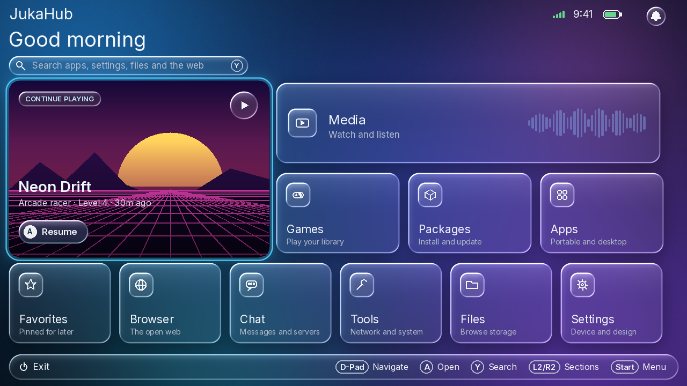
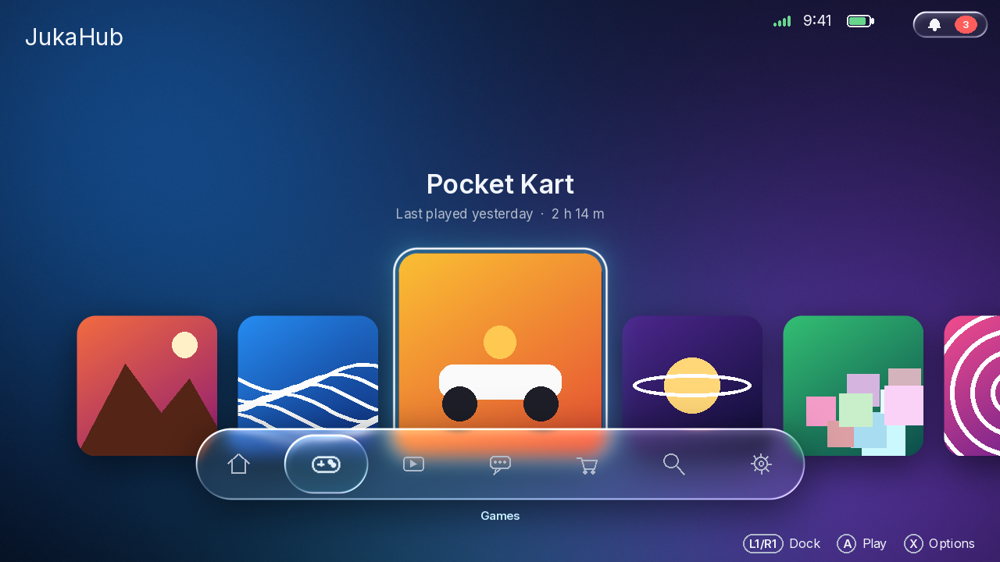
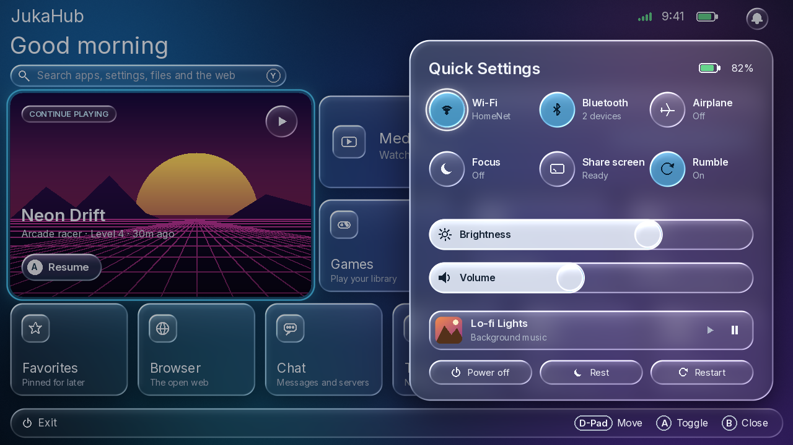
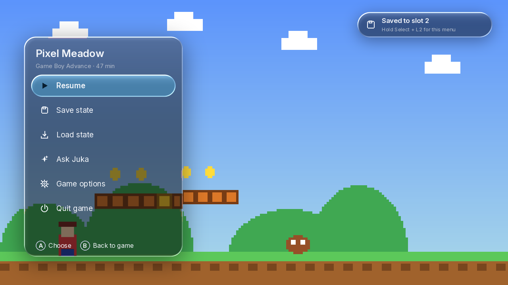
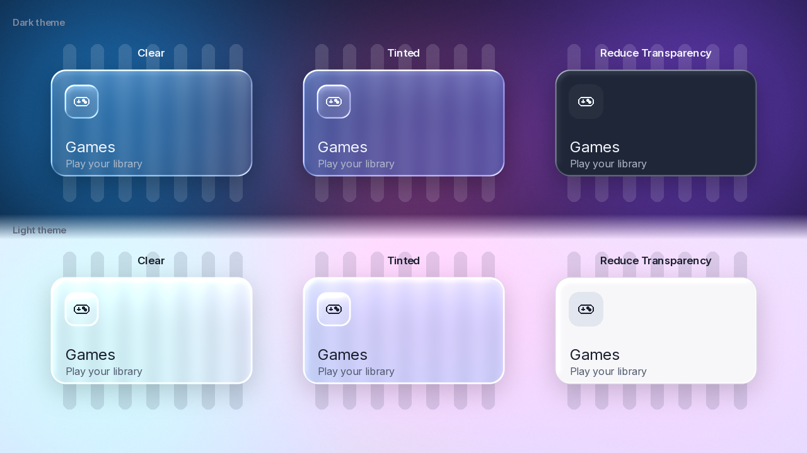

# Theme files

Theme files let you add a palette without editing JukaHub. Save one JSON file
per theme in the installation's `themes/` directory, for example
`themes/paper.json`. The file name without `.json` is the theme ID; `name` is
the label shown in the gallery. Built-in IDs take precedence, and an invalid
file is skipped.

Every color field below is required. Colors accept `#RRGGBB` or `#RRGGBBAA`;
the final byte in the second form is alpha. The optional `bloom` and `bloom2`
fields accept only opaque `#RRGGBB` colors.

| JSON key | Purpose |
|----------|---------|
| `name` | Required display name. |
| `background` | Base scene color; also selects the light or dark glass tint. |
| `buttonColor` | Tint used by authored buttons. |
| `labelColor` | General label color. |
| `inputColor` | Text-entry field surface. |
| `surface` | Main panel and card surface. |
| `surfaceAlt` | Alternate surface for secondary rows and sections. |
| `surfaceRaised` | Raised surface for cards above a panel. |
| `textPrimary` | Main headings and important values. |
| `textSecondary` | Body text and ordinary labels. |
| `textTertiary` | Captions, hints and quiet status text. |
| `borderSubtle` | Low-emphasis dividers and resting edges. |
| `borderDefault` | Standard card and control outlines. |
| `borderFocus` | Focused control outline. |
| `success` | Positive status fill or icon. |
| `warning` | Caution status fill or icon. |
| `danger` | Error or destructive status fill or icon. |
| `info` | Informational status color and the accent for focus rings and highlights. |
| `overlay` | Scrim color behind modal panels. |
| `summary` | Optional short note shown for a total-conversion theme. |
| `arrangement` | Optional Home layout. `dashboard`, `grid`, `carousel` and `widgets` make a total conversion; blank, `custom` or an unknown value leaves the layout alone. |
| `bloom` | Optional color for the first glow in Home's backdrop. |
| `bloom2` | Optional color for the second glow in Home's backdrop. |
| `carouselStyle` | Optional Home composition for the Carousel layout: `shelf` (PS4 game shelf), `strip` (equal square tiles), `ps1` (paged, bevelled system menu), `ps2` (vertical browser list and blue orbit), `psp` (horizontal icon crossbar and waves), `switch` (Switch 2 home screen), `hub` (PS5 welcome hub), or `text` (Minimal UI text list; aliases `minimal`, `list`). Blank or unknown keeps the centred carousel. Only visible with `"arrangement": "carousel"`. |
| `tileRadius` | Optional corner radius of Home's tiles and the shared cards, in 1280x720 design pixels, `0` to `32`. `0` or missing keeps 20. |
| `focusRing` | Optional `#RRGGBB` color for the ring around a focused Home tile. Missing uses `info`. |
| `focusRing2` | Optional `#RRGGBB` color the ring pulses toward for about two seconds after each move. Needs `focusRing`; the pulse stays off with reduced motion. |

Example:

```json
{
  "name": "Paper",
  "background": "#f4efe4",
  "buttonColor": "#e2d8c5",
  "labelColor": "#2b2924",
  "inputColor": "#ebe5d8",
  "surface": "#faf8f2",
  "surfaceAlt": "#eee9de",
  "surfaceRaised": "#e5dfd1",
  "textPrimary": "#241f18",
  "textSecondary": "#484238",
  "textTertiary": "#625b50",
  "borderSubtle": "#00000012",
  "borderDefault": "#c4baa7",
  "borderFocus": "#245d68",
  "success": "#2f6b3f",
  "warning": "#7f5900",
  "danger": "#a23a2a",
  "info": "#245d68",
  "overlay": "#f4efe4cc",
  "summary": "A warm paper palette",
  "arrangement": "grid",
  "bloom": "#e6c77a",
  "bloom2": "#c78c66"
}
```

## Styles and layouts

Theme presets has three tabs: Colour, Styles and Experience. Colour changes the
palette without moving Home cards. Home layout is a separate setting under
Settings → Theme & look, with Tabs, Standard, Hero grid, Carousel and Widgets.
The first-run tour offers the same five layouts with visual previews.

Styles contains console-inspired looks, Minimal UI and looks with their own
background glow. These can change colors, tile shapes, the Home arrangement
and the focus treatment, with no logos, fonts or artwork. Plain palettes stay
in Colour. Built-in combinations that only repeated a palette and a layout no
longer fill the gallery; existing saved selections still load. User-authored
conversion themes remain available in Styles.

| Theme | Palette in the Colour tab | Home | Look |
|-------|---------------------------|------|------|
| PS5 Style | PS5 Night | Carousel, `hub` | The welcome hub on a near-black page. "Games  Media" heads Home (a tap on Media opens it). Your Home tiles are one row of small rounded icon tiles; the focused one stands larger at the left with its name beside it, and the row ends at both sides. Under it, two pills (trophy progress, the game library) and a board of flat graphite cards: battery, Continue with its artwork, Chat, Trophies by tier, the last game played, Packages, Storage, Now playing and today's playtime. Down enters the board, A opens what a card shows, white focus ring, 10 px corners. Edit Home arranges the row and hides the board while open. |
| PS4 Style | PS4 Night | Carousel, `shelf` | Near-black navy with a deep-blue glow. Small 14 px rounded tiles run along the top-left; the focused tile is larger, with a white ring and its name and description beside it. (This was PS5 Style before the welcome hub.) |
| PS1 Style | PS1 Grey | Carousel, `ps1` | A six-tile paged system menu with light grey bevels, small controller-colour accents and a blue focus frame. Left and Right move between pages. |
| PS2 Style | PS2 Black | Carousel, `ps2` | A vertical browser list on black and deep indigo, with the selected item beside a blue orbit. Up and Down walk the list. |
| PSP Style | PSP Waves | Carousel, `psp` | A horizontal crossbar of floating icons above translucent blue waves. The selected item's name and detail sit below the row; Left and Right walk it. |
| Switch 2 Style | Switch Light | Carousel, `switch` | The console's home screen on light grey. Your picture sits in the top-left corner (A opens Trophies), the time, signal and battery in the top-right. One row of square tiles with 6 px corners: the games you played last come first, each its box art edge to edge, then your Home tiles as colour squares. The row scrolls only at its edges; the focused tile's name sits above it in cyan and a cyan outline pulses after each move. Under the row is a centred line of round buttons: Games, Chat (with its unread count), Store, Search, PlayStation Remote Play (on the handheld), Xbox Remote Play, Phone Companion, Settings and Power. A hairline, a controller glyph and the Start and A hints close the screen. The greeting, search pill, Remote Play pills, pairing code and power pill give way to the round buttons. Edit Home edits the tiles with its usual strip. |
| Switch 2 Style Dark | Switch Dark | Carousel, `switch` | The same home screen on charcoal grey. |
| Super Nintendo Style | Super Nintendo | Hero grid | Lavender grey with purple buttons; the Japanese pad's four colours as status colours. |
| Nintendo 64 Style | Nintendo 64 | Widgets | Charcoal with the four emblem colours; a yellow ring pulsing to green, 6 px tiles. |
| GameCube Style | GameCube Indigo | Dashboard | Deep indigo, 14 px tiles. |
| Xbox Style | Xbox Green | Widgets | Dark charcoal with green highlights and glow. The Widgets grid uses 8 px rounded rectangles with a white focus ring. |
| Xbox One Style | Xbox One | Hero grid | The 2013 Metro dashboard: near-black backdrop, flat square tiles (2 px corners), lime-green glow and a white focus ring. |
| Minimal UI | Minimal | Carousel (`text`) | Just text: black page, Home as a plain list of names, the focused one white with a thin bar before it and its description after it. No tiles, art or glows. |
| Mega Drive Style | Mega Drive | Dashboard | Black, red and gold, square 4 px tiles. |
| Dreamcast Style | Dreamcast | Carousel, `strip` | White with the swirl's orange, 16 px tiles. |

Game Boy and Sega Blue remain available as colour palettes. Choose Hero grid
separately to recreate their previous Home layout.

The third tab, Experience, is the Experience packs screen: a pack switches the
theme, Home, sounds and start screen together, with Undo. That screen shows the
same tabs, so Tab, L1/R1 or a click moves back to the presets.

To get the same look in your own theme file, set the matching
`arrangement`, `carouselStyle`, `tileRadius`, `focusRing` and `focusRing2`
keys from the table above.

## Menu colour

Settings → Theme & look → **Menu colour** keeps the theme (its backgrounds,
surfaces and text) and changes only its accent: the focus ring, pills, progress
bars and highlights. *Theme's own* (the default) leaves the theme's colour;
the ten others are Sky, Mint, Lime, Amber, Coral, Rose, Violet, Indigo, Teal
and White, mid tones that read on dark and light themes. A console look's own
focus ring (Switch, PlayStation…) follows the pick too.

The colour stays through everything that repaints the theme: picking another
preset, the light & dark schedule, Battery Saver's OLED theme, plugins,
experience packs, restoring a backup and a config reload. The usual readability
rules still apply, so a colour too close to the background (White on Light) is
darkened for the ring and for accent text rather than disappearing. It is
stored as `"menuColour": "theme" | "sky" | "mint" | "lime" | "amber" | "coral" |
"rose" | "violet" | "indigo" | "teal" | "white"` in the custom variables.

## Glass style

Settings → Theme & look → **Glass** chooses how JukaHub's glass looks.
*Classic* (the default) is the clear frosted pane with a hairline edge.
*Realistic* mimics Apple's Liquid Glass: what is behind a card or button is
blurred and slightly magnified, the top of the pane catches a sheen, a bright
rim follows the light from the top left (with a softer glint on the opposite
corner), and Home cards float on a soft shadow. Overlay sheets, small chips and
pills, and panes over videos or games get the light and rim but not the blur.
Realistic is off while Reduce Transparency or High contrast is on. It is stored
as `"glassStyle": "classic" | "realistic"` in the custom variables.

## Liquid glass concepts

These images are design concepts, not screenshots: they show where Realistic
glass could go next, and none of them is a shipping screen yet. Each pane is
drawn the way Realistic describes it (blurred and slightly magnified backdrop,
top sheen, a rim lit from the top left with a glint on the far corner, a soft
shadow), plus one thing the current renderer does not do: the last few pixels
of every edge bend the scene like the rim of a lens, with a faint colour
fringe. All data is made up (9:41, "HomeNet", the games and their art). They
are rendered by `branding/mkglass_concepts.py`; run
`python3 branding/mkglass_concepts.py` to redraw them after a change.

<p></p>

**Liquid Home.** The Home dashboard with every card, the search pill and the
footer in Realistic glass. The backdrop's lights show through each card, so
the row of cards shades from cyan on the left to violet on the right. The
Continue card keeps its artwork; only the chip, the play button and the
Resume pill are glass, and they bend the art under them. The icon wells are a
second, smaller layer of glass on each card.

<p></p>

**Floating dock with a lens.** The Carousel layout with a floating glass dock
in place of the footer. The covers sink a little behind the dock, so their
colours run through it (the orange kart cover glows in the middle). The
focused slot is a clear lens rather than a highlight: it magnifies the icon
under it, and moving with L1/R1 would slide the lens along the dock.

<p></p>

**Quick Settings sheet.** Quick Settings as one large pane over a dimmed Home.
Toggles are glass drops that fill with the accent when on; the focused one
takes the white ring. Brightness and Volume are glass capsules with a light
liquid fill and a clear thumb that magnifies the edge of the fill. Today's
overlay sheets get the rim but no blur, so this one would need the blurred
backdrop cached when the sheet opens.

<p></p>

**In-game menu over a running game.** The hold Select + L2 menu as clear glass:
over games the pane bends and magnifies the frame but does not blur it, which
keeps it cheap and keeps the game readable as context. A dark tint carries the
text. The "Saved to slot 2" toast uses the same glass.

<p></p>

**Clear, Tinted and Reduce Transparency.** The same Games tile on a dark and a
light theme. Clear is Realistic as it is now; Tinted mixes the accent into the
glass (iOS 26's tinted option) so text sits on a steadier colour; Reduce
Transparency drops the glass for an opaque surface with a hairline edge. The
stripes behind are there to show how much each one bends and blurs. Tinted
would be a third value of `glassStyle`; Reduce Transparency already exists and
already turns Realistic off.

## Glass rules

Glass is derived from the theme's `background` and `info` accent rather than
copied directly from the surface colors. On a dark background, controls use a
translucent white tint; on a light background they use deep slate with a
stronger alpha. The light or dark choice comes from background luminance.

The shared glass controls keep fixed strengths: resting fill is 13% tint, hover
17%, focused 20% and pressed 26%. The resting edge is 20% tint and the hover
edge is 40%; disabled controls use an 8% fill and 14% edge. A focused control
gets a three-pixel accent ring and lifts by three pixels. Light themes use a
deep-slate tint at 1.5 times the alpha (capped at full opacity); dark themes use
white. The `info` accent falls back to a legible focus color if it is too close
to the background.

Modal sheets are opaque blends of the background, 7.5% glass tint and 3.5%
accent, so content behind a sheet cannot show through its text. Recessed and
raised sheets use related mixes: the recessed sheet uses less tint, while a
raised card adds a light glass layer. Theme files do not set these glass
strengths. Choose text and surface colors with enough contrast for both regular
and derived glass surfaces. JukaHub derives readable text variants for semantic
status colors; their fills remain the authored colors.

For the rest of the configuration format, see
[Configuration](CONFIGURATION.md).
